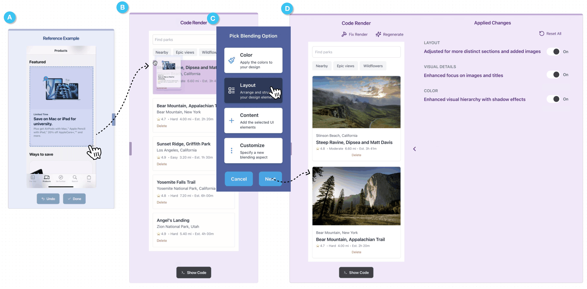

# Misty: UI Prototyping Through Interactive Conceptual Blending

Yuwen Lu
Note: Work done during internship at Apple.
Affiliation: University of Notre Dame, Notre Dame, IN, USA
email: ylu23@nd.edu
, 
Alan Leung
Affiliation: Apple, Seattle, WA, USA
email: alleu@apple.com
, 
Amanda Swearngin
Affiliation: Apple, Seattle, WA, USA
email: aswearngin@apple.com
, 
Jeffrey Nichols
Affiliation: Apple, Seattle, WA, USA
email: jwnichols@apple.com
 and 
Titus Barik
Affiliation: Apple, Seattle, WA, USA
email: tbarik@apple.com

Figure 1. The Misty system. Misty embodies the interactive conceptual blending interaction for UI prototyping, where UI developers *blend* selected sections of an example image A into work-in-progress UI code B. Users can *specify* aspect(s) of the image to blend in C. After viewing the blending output D, the user can further tweak details by toggling on/off within the *semantic diff* (that is, semantically categorized code changes) between the updated and original UI versions. Initially, the work-in-progress UI shows basic cards with some park information. The user selects the card layout from the example UI, drags it onto their current design’s cards, and chooses to blend the "Layout". Misty then generates updated UI code, preserving the original content but presenting it in a new card layout with images and hierarchical text descriptions, mirroring the example’s layout.

*Figure description (from the authors):* This figure illustrates the \sys{} system, an interactive conceptual blending tool for UI prototyping. The image is divided into four main sections labeled A through D. Section A shows a reference example UI with a featured product and navigation options. Section B displays a code render of a work-in-progress UI for finding parks. Section C presents a ``Pick Blending Option'' menu with choices for Color, Layout, Content, and Customize. Section D shows the blending output with an updated UI design and a list of applied changes. The accompanying text explains that \sys{} allows UI developers to blend selected sections from an example image (A) into their work-in-progress UI code (B). Users can specify which aspects of the image to blend in the menu (C). After viewing the blending output (D), users can fine-tune details by toggling on/off within the semantic diff, which shows semantically categorized code changes between the updated and original UI versions. This process demonstrates \sys{}'s capability to facilitate rapid, interactive UI prototyping through conceptual blending of design elements.
