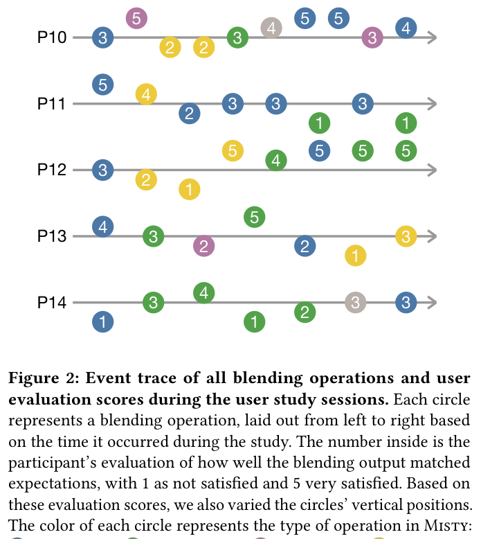
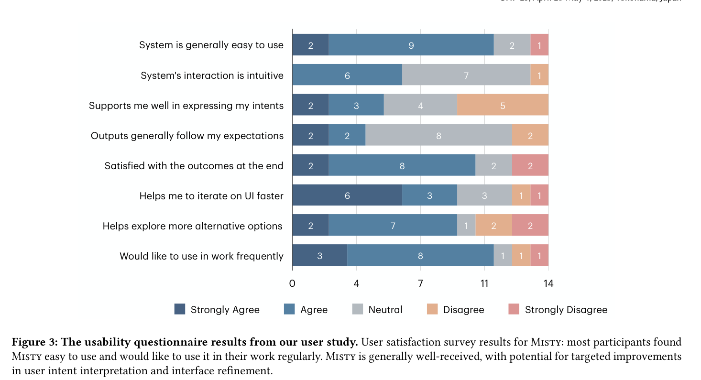

## 6. User Study Results

In this section, we provide the visualizations of participants’ conceptual blending operations (Figure 2) and their responses to the usability questionnaires (Figure 3). We also conducted a qualitative analysis of the user study sessions’ transcripts. These results together helped to answer our research questions regarding the value of Misty in UI development workflows.

### 6.1. Quantitative Results

To answer RQ1 and RQ2—how developers utilize Misty’s different features and to what extent Misty’s outputs satisfy developers’ expectations—we visualized the blending operations conducted by participants in Figure 2. The average time each participant spent interacting with Misty was 36.3 minutes (median 36, sd 7.0). On average, each participant conducted 7.4 blending operations during the session (median 8, sd 2.5). Some participants conducted fewer blending operations (e.g. P1, P5, P9), because they provided extensive feedback and rationale. For the total of 103 blending operations, participants used Global blending (36/103) and Drag-and-drop (35/103) the most, constituting 34.95% and 33.98% of all operations, respectively. Users also used Regenerate (19/103, 18.5%), Semantic diff (9/103, 8.74%), and Code editing (4/103, 3.88%) during the study.

After each blending operation, participants also evaluated how satisfied they were with each output on a 5-point Likert scale from “Very unsatisfied (1)” to “Very satisfied (5)”. The average satisfaction across all participants was 3.2 (median 3, sd 1.3). Out of all 103 activities, 31 received a satisfaction score below 3 (Unsatisfied or Very unsatisfied), 44 received a score above 3 (Satisfied or Very satisfied), with the remaining 28 rated 3 (Neutral). We noticed that some participants primarily expressed negative valence towards the outputs, for example, P7 and P14. These were mostly due to their high expectations of the outputs’ visual details, or the random nature of Misty’s underlying model’s behavior. Meanwhile, certain participants (e.g. P2, P6) showed generally positive valence towards the outputs. We observed that users’ responses to the usability questionnaire (Figure 3) were influenced by their blending output quality in Misty.

Nine out of the fourteen participants rated some blending outputs as “Very satisfied”, where Misty followed their expectations and captured the essence of examples in the updated code. Meanwhile, some blending outputs did not meet the users’ expectations, mostly because they either did not reflect the users’ expected changes or created UIs with non-ideal layout or alignment.

Regarding the usability questionnaire responses (Figure 3), most participants find Misty generally easy to use and would like to use it frequently in their work. However, opinions were mixed on how well it supported expressing user intents, with only 5 out of the 14 participants (35%) agreeing or strongly agreeing. Follow-up questions revealed that participants’ main concerns for this question were centered around usability issues in the prototype, such as cumbersome interaction details in drag-and-drop and imperfect feature discoverability. Moreover, participants explained that the strong disagreement responses came from receiving Misty outputs that failed to follow their instructions or didn’t meet their expectations for visual details (e.g., alignment, element sizing). These undesired outputs also reflected as low satisfaction scores in Figure 2.

For most participants who rated low on “Misty supports me well in expressing my intents”, they requested features to continuously improve Misty’s output after conceptual blending. For example, after receiving an output, participants wanted to ask the AI model to further iterate on output details. These iterations do not involve reference examples, and are therefore not directly related to our focus on conceptual blending.

When specifically asked about Misty’s features for intent expressions, such as cropping and drag and drop, participants did not raise any issues. They felt these features addressed their needs in blending operations, as we will discuss later in Section 6.2.2.

Figure 2. Event trace of all blending operations and user evaluation scores during the user study sessions. Each circle represents a blending operation, laid out from left to right based on the time it occurred during the study. The number inside is the participant’s evaluation of how well the blending output matched expectations, with 1 as not satisfied and 5 very satisfied. Based on these evaluation scores, we also varied the circles’ vertical positions. The color of each circle represents the type of operation in Misty:  Global blend,  Drag and drop,  Semantic diff,  Regenerate,  Code edit. We normalize the space between operations.

*Figure description (from the authors):* This figure shows activity logs for 14 participants (P1 to P14) in a user study. Each horizontal line represents a participant's session, with colored circles along the line indicating different operations performed over time. The circles contain numbers from 1 to 5, representing the participant's satisfaction score for each operation (1 being least satisfied, 5 being most satisfied). The vertical position of each circle also corresponds to this score, with higher scores placed higher on the line. Different colors of circles represent different types of operations. Blue circles are most common, followed by green circles as the second most frequent. Yellow circles appear occasionally, while purple and gray circles are less common. The number and spacing of circles vary between participants, showing different patterns of activity and satisfaction across sessions. Some lines have many circles clustered together, while others have fewer, more spread out circles. The image provides a visual representation of user interactions and satisfaction levels throughout the study, allowing for comparison between participants and identification of patterns in operation types and satisfaction scores.

Figure 3. The usability questionnaire results from our user study. User satisfaction survey results for Misty: most participants found Misty easy to use and would like to use it in their work regularly. Misty is generally well-received, with potential for targeted improvements in user intent interpretation and interface refinement.

*Figure description (from the authors):* This image displays a horizontal bar chart showing the results of a usability survey for a system. The chart presents responses to eight statements about the system, with answer options ranging from ``Strongly Agree'' to ``Strongly Disagree''. The survey covers various aspects of the system's usability. Regarding ease of use, 11 out of 14 respondents agree or strongly agree that the system is generally easy to use, with only one strong disagreement. The system's interaction is considered intuitive by 6 respondents, while 7 remain neutral. In terms of supporting user intents, opinions are mixed. Only 5 respondents agree or strongly agree that the system supports them well in expressing their intents, with an equal number disagreeing. Similarly, 4 respondents feel the outputs generally follow their expectations, while 8 remain neutral. Satisfaction with outcomes is relatively high, with 10 respondents agreeing or strongly agreeing, and only 2 strongly disagreeing. The system appears to help with UI iteration, as 9 respondents agree or strongly agree that it helps them iterate on UI faster. The system also seems beneficial for exploring alternatives, with 9 respondents agreeing or strongly agreeing that it helps explore more alternative options. Finally, there's a strong inclination towards frequent use in work, with 11 respondents agreeing or strongly agreeing they would like to use the system frequently at work. Overall, the chart indicates generally positive reception of the system, particularly in terms of ease of use and desire for frequent use. However, there are areas with more divided opinions, notably in how well the system supports expressing user intents, suggesting potential areas for improvement.

### 6.2. Qualitative Themes

To answer RQ3—understanding how Misty’s interactive conceptual blending workflow supports developers—we conducted a qualitative analysis of our user study by transcribing the interviews, segmenting the interview content into quotations, and organizing these quotations into meaningful themes. Our analysis resulted in six themes, and we present a summary of these themes in Table 2.

Table 2. Summary of qualitative participant feedback, organized by themes.

| Theme | Description | Representative Examples | Participants |
| --- | --- | --- | --- |
| *Kickstarting nascent creative explorations* (Section 6.2.1) | Participants found Misty valuable to accelerating early stages of UI exploration. | “I would want to use this to do the grunt work of setting up something.”  “I would definitely use Misty for giving me a head start which I can later improvise on.”  “It saves a good amount of time and effort from writing the code from scratch through any starting templates.” | P1–P4, P6, P10, P11, P14 |
| *Allowing flexible intent specification* (Section 6.2.2) | Participants appreciated the flexible intent specification mechanisms of Misty for various usage scenarios. | “It’s very useful when I can’t find any relevant templates to blend, I can just draw it as a sketch and use Misty to generate the UI.”  “The drag-and-drop is really good, it’s basically an alternative to manually fixing it.”  “Being able to come in and toggle these on and off through dynamic widgets to make the AI output manageable like this is really cool.” | P1–4, P6–12, P14 |
| *Generating code as a blending substrate* (Section 6.2.3) | Participants used the generated code in a variety of ways and noted their expectations of the generated code. | “Designers can do the prototyping design phase and we can just take the code and use it.”  “This section of the code will be reused many times and will componentize.”  “I wouldn’t necessarily expect it to make pixel perfect code, but I would something that I can then take from there and then bulletproof.” | P1, P3, P4, P12 |
| *Inspiring through serendipity* (Section 6.2.4) | Participants enjoyed unexpected blending outputs from Misty, which helps to provide inspirations they have not thought of. | “This one blend sparks joy because it is unexpected.”  “(Misty would be) useful to my work because it makes me think of things that I have not thought of.” | P2, P5, P7, P8, P10, P14 |
| *Refining iteratively and visually*  (Section 6.2.5) | After their initial explorations, participants desired additional capabilities to support further iterative refinement of their UIs. | “I just want to tell it (Misty) to fix it without dragging and dropping”  “A designer wants to be pixel perfect.”  “I’d love for the ability to add text to the prompt like I could when I was adding parts of a design to full styles.” | P1, P2, P8–10 |
| *Blending boundaries between designers and developers* (Section 6.2.6) | Developers can see Misty as a tool for both themselves and designers, complementing each group with the other group’s skills, and blends the boundaries between these roles. | “This blends the boundary between designer and developer.”  “It does a good job of covering for my lack of design skills.”  “(Misty is) raising the bar for developers of the app as far as the look and feel.”  “If designers use Misty to ‘generate some code’, I can use it immediately.” | P1–4, P6, P12–14 |

#### 6.2.1. Kickstarting nascent creative explorations

All participants reported the use of examples in their UI development workflows. Developers would look for relevant UI examples online or find examples from component libraries. Then, they would often manually recreate these examples from scratch using the framework for their own projects (P3, P6, P8–10, P11, P14). The open source culture in web development—as well as browser inspection tools—allowed developers to easily “borrow aspects of the design inspirations from others” (P3) and build their UI from these starting “patterns” (P4).

Misty supports developers by scaffolding and accelerating exploratory UI prototyping in early stages of development workflows, especially “being useful in very fast development” (P3). This is triangulated by the usability questionnaire results, where most participants agreed that Misty helps to “iterate on designs faster” and “explore more alternative design options”. Participants “would want to use this (Misty) to do the grunt work of setting up something” (P11). P4 estimated that Misty “will add productivity boost to our work by 20%–30%”, since 30%–40% of their current work time is spent on creating CSS and static UI mockups. Participants prefer to take Misty’s output versus creating UI manually, as it can automate tasks that would take them 20–30 minutes to do otherwise (P10).

#### 6.2.2. Allowing flexible intent specification

Participants appreciated Misty’s diverse input mechanisms for specifying design intent, which supported various stages of their development process. The ability to blend in full screenshots, specific aspects of example UIs, and hand-drawn sketches proved efficient for different phases of UI development. For early ideation, participants valued the option to start exploring with generally blending in full screens or hand-drawn sketches. Particularly, hand-drawn sketches are widely used in roughly laying out design concepts and communicating design ideas. The ability to blend in sketches fits well with developers’ current practices (P3, P6, P11, P12), especially “in the case (when) I have an idea in mind, for which I cannot find any relevant template online” (P6). P3 noted “a lot of my time is just translating a sketch… this (Misty) can save me time on making the code or the visual look, so I don’t have to fight with CSS and layout”. As designs progressed, participants found value in having more specific input options. P3 noted, for example, that drag-and-drop is very good for updating existing products, instead of starting brand new ones.

#### 6.2.3. Generating code as a blending substrate

Participants proposed utilizing the generated code in different ways, including as another avenue for refining the UI blending results (Section 6.2.5) to “easily fixing little things“ (P2) or adjust other “minute aspects like font or spacing that’s quicker to just do myself” (P14). For some participants, authoring user interface code for presentation is tricky, and Misty can help developers avoid “having to fight with CSS” (P3) and the tool “would help with a lot of the presentation boilerplate” (P1).

Other participants desired to “take the code and just use it“ (P4) or to uplift an “existing legacy app interface to generate compatible but modern React and Tailwind” (P3). P11 elaborated on their expectations around this code generation hand-off: “With these kinds of systems, I wouldn’t necessarily expect it to make pixel perfect code, but I would want the code that it resulted in to be something that I can then take from there and then bulletproof myself.”

A gap in Misty is that some participants wanted the code generation to emit UI components that map to their own libraries and design systems (P1, P5, P6, P10, P12). For example, P12 suggested organizing the output code into components, to better fit into the Atomic Design principles (Frost, 2016): “If it (Misty) could build that as a component, or at least tell me that this thing is repetitive (reusable), that would solve a major problem.” In some situations where Misty complements designers, “developers might not have the freedom to output any design they like” (P6). A future version of Misty could allow preloading a set of design components for the tool to draw from or take advantage of custom data schemas—that is, “being able to fill in the UI with my own list of data” (P1)—when these are made available to the Misty.

#### 6.2.4. Inspiring through serendipity

A benefit of Misty was its ability to generate surprising blending outputs that inspire developers. Six participants (P2, P5, P7, P8, P10, P14) reported enjoying serendipitous outputs that sparked new ideas. During the study, P2 received a particularly unexpected yet inspiring blend “that sparks joy”. This sentiment was echoed by P5, who found Misty’s surprise blends “to the most useful to my work, making me think of things that I have not thought of.” These experiences suggest that Misty stimulates developers’ creativity, pointing out new design directions outside of established patterns.

However, serendipity can also be a double-edged sword. Although some of the blends initially have an “amazing wow factor” (P10), when carefully scrutinizing the blend there are often small details that were initially overlooked, such as the “separation between items and not apply the button design style to one of the buttons” (P10). The randomness, which “can be good in exploration” (P7), is “also bad when you already know where to go” (P7) or “have a specific idea in mind” (P3). For such scenarios, having a “more deterministic way of working with the tool would be preferred” (P3). This experience made P3 “impressed by some things and yet underwhelmed by others.”

To address these trade-offs, a future improvement could give a knob to the developer that allows them to indicate their preference for serendipity. Earlier in the design process they may set this preference higher, and lower it later in the design process when they know more precisely what design they want.

#### 6.2.5. Refining iteratively and visually

While Misty helps in initial explorations, participants needed more support for iterative visual refinement after the initial exploratory phases (P1, P2, P8–10). Participants often found themselves wanting to make precise adjustments directly over the output, without drag-and-drop of another example. Participants wanted the ability to “add text prompt to the output, like I could when I was adding parts of a design to full styles” (P8). This comes from a demand for pixel-perfect UI implementations in professional contexts, which current models are not always able to produce (Si et al., 2025; Wu et al., 2024). From many UI developers, they are expected to produce pixel perfect implementations, especially by designers (P3). As a result, when seeing issues in the blending outputs’ visual details (e.g. element sizing, alignment, and color values), developers naturally wanted to fix them with direct prompt iterations over the visually rendered UI. This is currently only supported by direct editing in our code editor. However, developers also recognized that they are fine with manually tweaking these details. While the blending outputs were not pixel perfect, developers generally thought they were “good enough output for me to build upon” (P4), then, “the minute interaction of copying over font or changing some spacing, that’s something I can do way quicker by myself” (P14). Yet, developers can still benefit from direct iterations on the visual outputs in Misty, without necessarily involving more examples.

#### 6.2.6. Blending boundaries between designers and developers

P2, P4, and P13 considered both designers and developers as potential user groups that can benefit from using Misty. The system showed potential in blending designer and developer activities in UI prototyping, shifting collaboration and handoff points in the full prototyping workflow. This is noted by eight participants in our study. P1, P4, and P14 mentioned the shifting handoff points between designers and developers, where traditionally they only receive design artifacts that contain no code implementation. If designers use Misty to generate some code, developers can directly take the code and immediately use it in their implementation (P1). Misty can also help developers to incorporate stakeholder feedback faster, enhancing cross-function collaboration (P12) and reducing the friction with designers (P3, P13).

At a higher level, Misty also complements designers and developers with each others’ skills. P2 noted that Misty “does not replace me, but does a good job of covering for my lack of design skills.” Misty helps to raise the bar for design for developers’ UI implementations. Participants imagined designers using Misty may not have to rely on engineers and vice versa (P11). In the future, tools like Misty will continuously lower the boundary of entry for both UI design and development, changing the separated dynamics and goals for these two roles.
