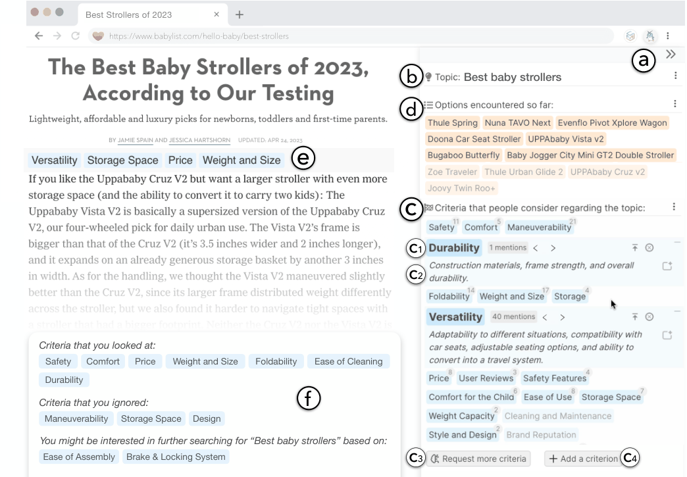

## 1. Introduction

Whether it is parents delving into the vast sea of baby stroller choices or developers comparing different JavaScript frontend frameworks, people frequently find themselves having to make sense of unfamiliar domains and performing comparisons to make informed decisions.
In these situations, people often have to iteratively find, read, collect, and organize large amounts of information about different options with respect to various criteria (Kittur et al., 2013; Kittur et al., 2014; Liu et al., 2018), which can become a messy and overwhelming experience (Chang et al., 2020; Liu et al., 2022a).

One challenge lies within the initial reading process — due to unfamiliarity with the topic, people may struggle to fully understand certain content or fail to recognize important aspects that should otherwise warrant their attention (Klingberg, 2009; Plumlee, 2003) as they read, leading to a limited viewpoint or ultimately misguided decisions (Yaniv and Choshen-Hillel, 2012; Hall and Davis, 2007).
For example, novice developers might not be aware of criteria crucial to the utility of a software library, such as its stability, community size and support, or ease of integration with existing codebases, resulting in making a sub-optimal choice.

Figure 1. The main user interface of Selenite, which provides users with a comprehensive overview of the information space in the sidebar (a). When users encounter an unfamiliar topic (b), Selenite offers them a global overview based on commonly considered criteria (c) as well as the options encountered so far (d), helping them develop quick intuitions of the topic. As users read articles that they haven’t seen before, Selenite provides local grounding through page-level and paragraph-level summaries and annotations (e), enabling effective comprehension and efficient navigation between the content of their interests. Before leaving a page, Selenite dynamically summarizes users’ progress and suggests avenues for finding additional new information (f) in subsequent searches.

Another challenge arises when people have to sift through numerous online reviews and comparison articles but with limited time and cognitive bandwidth, making a complete understanding of the information space impractical or impossible.
Instead, people often adopt a “selective” (or non-linear) reading strategy (Willows and MacKinnon, 1973), only reading the paragraphs that discuss information that they consider relevant or valuable and bypassing the rest (Willows, 1974; Cunningham and Shablak, 1975), e.g., in a focused session where they would like to compare different options with respect to the same criterion. However, it is challenging for people to gauge the potential value of articles or paragraphs, especially long-winded ones, just by skimming and without performing a more thorough read (Buder et al., 2015; Farkas and Raleigh, 2013; Fok et al., 2023).
For instance, information snippets about the maneuverability of different baby strollers may be dispersed throughout a review and appear in diverse variations (e.g., “agile enough to go through tight spots” and “easy to steer and navigate small corners” both discuss “maneuverability”), making it difficult for people to spot these variations effectively and navigate efficiently among such scattered details.

In response to these difficulties, prior work on sensemaking and knowledge reuse has shown promising evidence that people would benefit from seeing an *overview* of the information space *before* they dive into the sensemaking process(Paul and Morris, 2009; Morris and Horvitz, 2007; Chang et al., 2019; Suh et al., 2008; Fisher et al., 2012) — for example, Kittur et al. reported that having read an overview of the criteria that earlier users found useful can help people build intuition and understanding of the decision space upfront, leading to significantly improved digestion of the source material, better-structured mental models, and ultimately more well-informed decisions (Kittur et al., 2013; Kittur et al., 2014). Similarly, our formative study found that people expressed a desire for such comprehensive overviews to help them more systematically read, understand, and strategically navigate unfamiliar information. However, existing sensemaking systems have struggled with the “cold start” issue — they often require substantial effort from the current user to personally go through the unfamiliar content and gather and structure information to obtain such an overview (Liu et al., 2019; Kang et al., 2022; Baldonado and Winograd, 1997; schraefel et al., 2002; Kittur et al., 2013), which defeats the premise of receiving one upfront. And even if a previous user has generated such an overview, it can often be incomplete (Paul and Morris, 2009; Liu et al., 2021), biased (Flanagin and Metzger, 2000; Hoorn and Wijngaarden, 2010), or in idiosyncratic formats that make it hard for the current user to readily understand and leverage (Liu et al., 2019; Hsieh et al., 2018; Horvath et al., 2022; Liu, 2023).

To overcome these challenges and go beyond prior systems, we explore the idea of providing users with a comprehensive overview of the information space upfront to jumpstart as well as guiding their subsequent sensemaking processes in a novel system named Selenite. [Footnote: Selenite is named after a soft and transparent gemstone, and stands for “ S mart E nvironment for L ogical E xtraction and N avigation of I nformation using T echnological E xpertise.”] At a high-level, when users encounter an unfamiliar topic, Selenite leverages GPT-4, an LLM developed by OpenAI, as a knowledge retriever to offer them a global grounding based on commonly considered criteria, helping users develop quick intuitions of the topic (Figure 1c). As users read new articles, Selenite contextualizes that overview and uses it as an index to help users effectively comprehend and efficiently navigate among the content of their interest (Figure 1e).
Upon leaving a page, Selenite dynamically summarizes users’ progress and suggests unique search queries that would help users find additional information and expand their perspectives rather than duplicating existing knowledge (Figure 1f).
Through an intrinsic evaluation of Selenite, we verified its feasibility to provide a sufficiently accurate and high-quality global overview to users. Furthermore, additional usability and case studies revealed that Selenite accelerated users’ information processing, facilitated their comprehension, and improved their overall reading and sensemaking experience. The contributions described in this work include:

- a formative study showcasing people’s barriers and needs when reading and understanding information during online sensemaking,
  despite recent advances in information management tools,
- Selenite, a novel system providing users with an upfront comprehensive overview of the information space as well as interactively guiding their subsequent reading and sensemaking processes,
- as part of Selenite, a novel user interface to interact with LLM-generated content and a novel user experience to contextualize that content into people’s existing sensemaking workflows, going beyond the widely-adopted conversational interfaces in generative AI research and applications (Capra and Arguello, 2023; Wondershare, 2023; BlockTechnology, 2023; Anthropic, 2023; OpenAI, 2023a; Ma et al., 2023).
- an intrinsic evaluation of Selenite that demonstrates the feasibility of our approach, as well as usability and case studies that offer preliminary insights into its usefulness and effectiveness,
- a discussion of design implications for future LLM and AI-powered sensemaking systems and tools.
