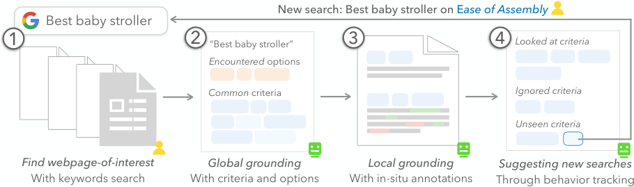
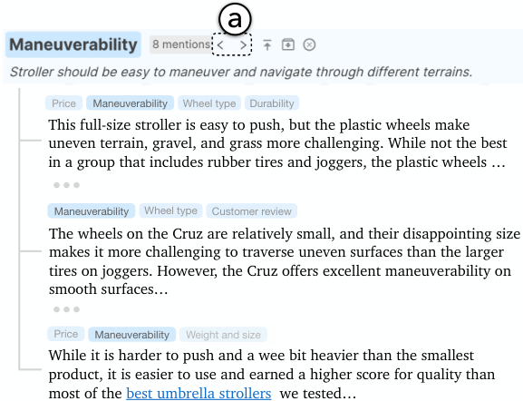
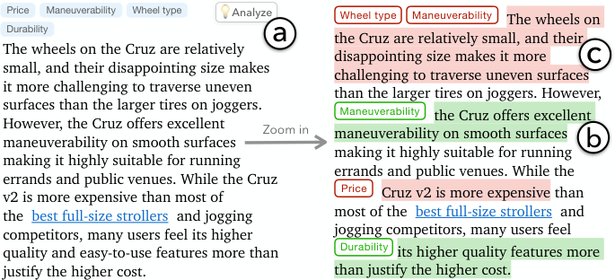

## 4. The Selenite System

Based on the design goals, we designed and implemented the Selenite Chrome extension prototype to help people read about and make sense of unfamiliar topics with the help of global grounding (summarized in Figure 2). We will first illustrate how an end-user, Mirri, would interact with Selenite.

Figure 2. Main stages and features of Selenite: After the user 1) searches and finds an initial webpage-of-interest to read, Selenite provides: 2) global grounding with a set of common criteria as well as options encountered so far, 3) local grounding with in-situ annotations of criteria per paragraph, and 4) suggestions on what to search for next to gain new information.

### 4.1. Example Usage Scenario

Mirri, an expectant mother, is seeking guidance in picking a stroller for her upcoming baby. As someone without prior experience in child-rearing, she decided to rely on Selenite to help her while going through review articles and product pages of baby strollers.

Mirri did a quick Google search and clicked on the first result page, which appeared to be a review article titled “The 10 Best Baby Strollers Put To The Test”. Upon opening the page, Selenite automatically recognized the topic of the page as “best baby strollers” (Figure 1b), and then automatically presented an overview in a global sidebar available on every page (Figure 1a). The overview contained a list of criteria (Figure 1c) that are commonly considered by people when investigating the topic, such as maneuverability and durability. In addition, Selenite also automatically parsed the web page content and extracted the different baby stroller options and presented them under the “Options encountered so far” section (Figure 1d) in the sidebar.
After quickly skimming the overview, Mirri now felt that she has already built an intuition about what criteria she should care about when picking baby strollers before even delving into the article itself.

Based on the global options and criteria, Selenite *contextualizes* the ones that are covered on the current page by highlighting them in the sidebar (and conversely low-lighting the ones that are not present, for example, see Figure 1c&d), helping users better understand and find specific information of interest while browsing.
In addition, as Mirri read the article, she noticed that Selenite provided in-situ annotations of mentioned criteria at the beginning of each paragraph
(Figure 1e).
She quickly learned that she could just skim those mentioned criteria to get a rough idea of what a particular paragraph is about and decide if that paragraph is worth reading.

When she came across information about the maneuverability of a specific stroller,
Mirri became interested in finding out if there were any details about the maneuverability of other stroller options as well. To facilitate this, she used the “previous/next” buttons (Figure 3a) to quickly navigate among the paragraphs that discussed maneuverability. Here, the aforementioned annotations not only offer paragraph overviews during *linear* skimming but also act as bookmarks for *non-linear* navigation between distinct parts of the page that pertain to similar criteria.

Later, when Mirri encountered a particularly convoluted paragraph with multiple criteria and options that she couldn’t quite absorb after a first pass, she decided to leverage the “zoom in” feature that Selenite offers — querying for more comprehensive descriptions that clarify which sentences or phrases within the paragraph pertain to specific criteria and sentiments (positive, neutral, or negative) (Figure 4) by clicking the “Analyze” button (Figure 4a) that appears when hovering the cursor over a paragraph.

Figure 3. Selenite enables structured and efficient navigation by criterion through clicking the “previous/next” (shown as “<” and “>”) buttons (a), after which Selenite will automatically scroll the page to reveal the previous/next mentioning of the target criterion.

After Mirri reached the end of the current article, Selenite presented a summary block (Figure 1f), automatically summarizing her research progress (e.g., criteria from the overview that she has actually read about). With the help of this summary, Mirri realized that she hasn’t seen evidence related to ease of assembly or brake & locking system before. She then specifically searches for them on Google, finding new articles that contain information about these previously unencountered criteria.

### 4.2. Detailed Designs

We now discuss how the various Selenite features are designed and implemented to support the design goals.

#### 4.2.1. [D1] Providing Global Grounding using Common Criteria and Options Encountered

In Selenite, we explore the idea of having the system provide users with an initial overview of criteria that are typically significant and frequently considered by people when exploring a particular topic.
Selenite also performs information extraction on each page to identify the options that a user has encountered during their sensemaking process. Naturally, users have the flexibility to reorder, pin, edit, add, or delete any options and criteria to tailor them precisely to their specific preferences. We discuss the relevant designs and the rationale behind those designs below:

Figure 4. When encountering a particularly convoluted paragraph (e.g., the paragraph on the left) with multiple criteria and options that users can’t quite absorb in the first pass, they can click the “Analyze” button (a) and leverage the “zoom in” feature that Selenite offers to query for more comprehensive descriptions that clarify which sentences or phrases pertain to which specific criteria and sentiments. Selenite wraps phrases and sentences in colored boxes, with green denoting “positive” (b), red denoting “negative”, and grey denoting “neutral” (not shown).

##### Automatically recognizing topics.

Selenite goes beyond previous sensemaking systems (Liu et al., 2018; Chang et al., 2021; Kittur et al., 2014; Liu et al., 2022a; Kittur et al., 2008; Liu et al., 2022b; Liu et al., 2021) by autonomously identifying and classifying web pages into broad topics based on their titles and content.
Unlike previous systems that require users to manually determine the topic (Chang et al., 2020; Liu et al., 2019; Hahn et al., 2018), automatic topic recognition further lowers the barrier for entry, enabling users to quickly begin reaping benefits from the list of commonly considered criteria based on that topic.
To achieve this, we frame the topic recognition as a *summarization* task for an LLM —
specifically, we asked GPT-4 (taking advantage of its generalizability to various domains (OpenAI, 2023b)) [Footnote: Please refer to section D.1 in the Appendix for the detailed prompt design.] to first *summarize* an arbitrary web page given its title and initial five paragraphs (with the temperature set to 0 to minimize LLM hallucination). [Footnote: Empirically, we found this step helped GPT-4 to better engage with the context provided. It also aligns with the idea of Chain-of-thought prompting proposed by ( Wei et al., 2023 ) , and then offer a search phrase that would help one to find similar web pages using a modern search engine, which we use as the topic.] Selenite then clusters the semantically similar topics (note that each web page has an associated topic generated by GPT-4) based on the cosine distances on topic semantic embeddings computed using SentenceBERT (Reimers and Gurevych, 2019).
Therefore, for example, websites titled “React vs. Svelte: Performance, DX, and more,”
“Angular vs React vs Vue: Which Framework to Choose,”
and “What are the key differences between Meteor, Ember.js and Backbone.js?”
would all be regarded as “Comparison of JavaScript frameworks.”
Naturally, users have the flexibility to manually create, edit, and remove topics, as well as reassign pages to different topics based on their personal opinions.

##### Automatically retrieving commonly considered criteria.

If we adopt the “bottom-up” approach discussed in prior work (Hahn et al., 2018; Liu et al., 2019; Kuznetsov et al., 2022), an intuitive method for obtaining criteria would involve extracting them from individual paragraphs on a page.
However, in our initial attempts, we found that this method faced significant challenges that limited its effectiveness. One of the main issues was the lack of uniformity among the criteria extracted from different paragraphs — each paragraph presented its own variations and nuances, making it difficult to establish a cohesive and standardized set of criteria (similar to what was reported by our formative study participants). Additionally, the approach lacked a comprehensive global perspective, failing to consider the broader context and overarching themes of the topic. As a result, manual review, correction, and unification of the extraction results were frequently necessary, making the process impractical and inefficient.

| Criterion Name | Criterion Description |
| --- | --- |
| Safety | Ensuring the stroller has proper safety features such as a secure harness, sturdy construction, and reliable brakes. |
| Comfort | Providing a comfortable seat with adequate padding and support for the baby, as well as adjustable recline positions. |
| Maneuverability | Having easy & smooth maneuverability, with features like swivel wheels, suspension systems, and the ability to navigate tight spaces. |
| Durability | Ensuring the stroller is built to last, with high-quality materials and strong construction. |
| Storage | Offering ample storage space for carrying essentials such as diaper bags, snacks, and personal items. |
| Folding and Portability | Allowing for easy folding and compact storage, as well as being lightweight for convenient transportation. |
| Versatility | Providing features that allow the stroller to adapt to different terrains, weather conditions, and age ranges. |
| Ease of Use | Having user-friendly features like adjustable handles, intuitive controls, and easy-to-clean fabrics. |
| Price | Considering the affordability and value for money in relation to the features and quality of the stroller. |
| Customer Reviews | Taking into account feedback and recommendations from other parents who have used the stroller. |
| Weight and size | Considering the weight and size of the stroller to ensure it is manageable and fits well in different environments. |
| Ease of cleaning | Ensuring the stroller is easy to clean and maintain, with removable and washable fabric components. |
| Adjustability | The stroller should have adjustable handlebars and footrests to accommodate different caregivers and growing babies. |
| Canopy | A large and adjustable canopy to protect the baby from the sun and other elements. |
| Reversible seat | Having the option to face the baby towards the parent or away from the parent. |
| Brake system | Having a reliable brake system that is easy to engage and disengage. |
| Car seats compatibility | Offering the ability to attach a car seat to the stroller for convenient travel. |
| Adjustable height | Allowing for adjustable handlebars to accommodate different heights of caregivers. |
| Easy assembly | Providing clear instructions and easy assembly process for the stroller. |
| Design and aesthetics | Considering the overall design and aesthetics of the stroller to match personal preferences. |
| Weight capacity | Specifying the maximum weight limit the stroller can safely carry. |
| Warranty | Checking for a warranty or guarantee that covers any potential defects or issues with the stroller. |
| Brand reputation | Considering the reputation and reliability of the brand manufacturing the stroller. |
| Accessories | Offering additional accessories such as rain covers, mosquito nets, or parent organizers for added convenience. |

Table 1. Commonly considered criteria (name & description) that Selenite retrieves for the topic of “best baby strollers.”

To address these challenges, we instead explored an alternative “top-down” approach, where we directly query an “oracle” for a globally applicable and comprehensive set of criteria.
We were particularly inspired by recent research suggesting that *the majority of people’s information-seeking needs are not novel* (Liu et al., 2023b) — “previous people” have experimented with most search needs and synthesized information into summarized knowledge such as review articles. While it is impractical for individuals to process and synthesize vast amounts of information online, LLMs excel at this. Recent studies suggest that LLMs can be highly effective in processing and integrating information, making them potentially valuable for tasks like knowledge graph querying and retrieving common sense information (Yang et al., 2022; AlKhamissi et al., 2022; Wang et al., 2020), and, in our particular case, a suitable “oracle” for providing a set of commonly considered criteria given a particular topic.

In Selenite,
we use GPT-4 as a *knowledge retriever* — for any given topic, we prompt it to produce a list of around 20 commonly considered criteria (Figure 1c), complete with their respective names (Figure 1c1) and descriptions (Figure 1c2) for each topic.
To minimize potential anchoring biases, we strive to achieve a balance between relevance and diversity in our prompting strategy.
First, we specifically requested an initial set of criteria that are deemed as “most relevant to the topic,” “frequently considered,” and can “cover a broad range of perspectives.”
Then, we iteratively prompted GPT-4 while applying the Self-Refine technique (Madaan et al., 2023), where in each iteration, we requested the generation of five additional criteria that were ‘‘different, more diverse, and more important’’ than the previous ones. [Footnote: Please refer to section D.3 in the Appendix for the detailed prompt design.]  We also relied on GPT-4 for ranking the criteria based on their importance.
Still, users have the freedom to request additional criteria (without repetition) if they believe the existing list is not comprehensive enough (Figure 1c3), or manually add criteria (Figure 1c4).
We present in Table 1 the list of criteria that Selenite retrieves for the topic of “best baby strollers,” offering an intuition of their quality and coverage.
We further validate our approach through a performance evaluation in section 5 that provides initial evidence that our approach is sufficient for our prototyping purposes. We leave for future work to experiment with advanced approaches, such as retrieval-augmented generation (RAG) (Lewis et al., 2020), that would potentially provide increased perceived external validity.

##### Automatically recognizing encountered options.

Instead of relying on GPT-4 to access its internal knowledge and retrieve a set of commonly considered options, we instead leverage its zero-shot *information extraction* capability
and expansive context window size (OpenAI, 2023b)
to directly extract options from the entire text content of a web page. This approach ensures that the options presented in the sidebar align with a user’s sensemaking process, i.e., they are indeed what users have encountered as opposed to something that users would potentially never run into. It also circumvents the potential concern where the world knowledge of an LLM is out-of-date, for example, at the time of writing, GPT-4 only “knows” information up to September 2021 (OpenAI, 2023b). [Footnote: While the direct retrieval of criteria from LLMs may also face this potential issue, in practice, we operate under the assumption that criteria are unlikely to suddenly emerge or become outdated.] In addition, it surpasses the limited heuristics employed in previous approaches such as Crystalline (Liu et al., 2022a), which rely on page titles and HTML <h>-tags as sources for options.
This is crucial, because studies have consistently demonstrated that web pages frequently disregard semantic web standards and best practices (Mendes et al., 2018; Henschen and Lee, 2009). [Footnote: For instance, it is common to find pages where nearly every piece of content is enclosed in 
 tags regardless of their semantic roles.]

#### 4.2.2. [D2] Providing Local Grounding using Page & Paragraph-level Summary and Annotation

To address the challenges identified in the formative study, where complex paragraph and page structures frequently led to overlooked information and hindered user comprehension, Selenite introduces the following features:

##### In-situ summaries and annotations of paragraphs.

With access to the initial set of common criteria as well as the options extracted from each page, Selenite performs content analysis on each paragraph within a given page to identify the specific criteria being discussed and presents them as in-situ annotations above the respective paragraph (Figure 1e). This feature enables users to swiftly scan through a page, understand the key points of each paragraph, and selectively concentrate on the paragraphs that are valuable and engaging for gathering information.

Such content analysis is enabled by recent advances in large pre-trained transformer models (Vaswani et al., 2017; Devlin et al., 2019; Lewis et al., 2019) fine-tuned to perform zero-shot text classification tasks following a natural language inference (NLI) paradigm (Yin et al., 2019). Specifically, for example, to assess if a given text (e.g., “Angular is very hard to pick up”) covers the criterion of learning curve, we can input the text as the *premise* and a *hypothesis* of “This content discusses {learning curve}.” into the NLI model. The entailment and contradiction probabilities are then converted into label probabilities, indicating the likelihood that the content pertains to the specified criterion. We used the bart-large-mnli model [Footnote: The model can be accessed on-demand through a remote API service that we implemented.] for this purpose and considered options and criteria with a score above 0.96 as true positives, displaying them in descending order of scores. We determined this threshold empirically, prioritizing recall over precision, as discussed further in section 5.

In scenarios where users still struggle to comprehend content despite the presence of in-situ annotations, Selenite can perform a deeper analysis on-demand by leveraging the advanced reasoning capabilities of GPT-4. Specifically, through parallel and carefully orchestrated prompts, Selenite produces a more comprehensive description that clarifies which sentences or phrases pertain to specific criteria and sentiments (positive, neutral, or negative) (Figure 4). Although a formal evaluation of this method is beyond the scope of this work, recent research suggests that content analysis conducted by the latest generation of LLMs achieves state-of-the-art performance in terms of quality, accuracy, and granularity (OpenAI, 2023b; Bubeck et al., 2023), making it suitable for our purposes.

##### Page-level overview of options and criteria.

As evidenced by our formative study, providing a page-level overview of the information space to users can greatly assist them in reading and sensemaking tasks. To facilitate this, Selenite consolidates paragraph-level metadata into the sidebar’s options and criteria entries, with the entries that are present on the page highlighted (Figure 1c&d). This offers two key benefits. First, it provides a comprehensive summary of all the available options and criteria specific to the current page, which allows users to quickly understand the focus of the page as well as judge its value against their personal interests and needs. Second, it enables structured and efficient navigation. By utilizing the “previous/next” button for a given criterion (Figure 3a), users can swiftly navigate between distinct parts of the page related to identified criteria (Figure 3). This feature saves users time and effort, as it eliminates the need for manual searching and filtering, which our formative study found to be the common practice.

It is worth noting that the combination of page and paragraph-level annotations effectively addresses a significant prior limitation highlighted by Crystalline (Liu et al., 2022a) and further revealed in our formative study: the inability to manually recognize “latent/implicit criteria,” where the same criterion can be expressed in various forms without being explicitly mentioned (for instance, it can identify the criterion of “price” from a statement like “I bought this mp3 player for almost nothing” (Poria et al., 2014)).

#### 4.2.3. [D3] Dynamically Suggesting Next Steps in Sensemaking

As users navigate through a page and consume the content, Selenite implicitly keeps track of the criteria and aspects that they paid attention to on the page based on dwell time, that is, the amount of time they roughly spent reading a block of content, as specified in (Liu et al., 2022a; Chen et al., 2022).
Selenite then uses this information to summarize the user’s research progress in the aforementioned summary block (Figure 1f), which consists of three sections:
(1) criteria that users cared about and have seen evidence for based on implicit tracking (emphasizing their focus and priorities),
(2) the remaining ones that are discussed on the page but users ignored or skipped [Footnote: The threshold of determining if the user indeed paid attention to a paragraph is set to 2 seconds based on our empirical testing. Future work can investigate more adaptive methods, such as taking into account the length of a paragraph, the amount of new information contained in a paragraph compared to users’ existing knowledge, or if users appear to be idling and performing irrelevant activities.]  (reminding users of potentially overlooked criteria), and
(3) a set of recommended criteria from the global overview that haven’t been discussed in any of the past articles but could still be worth exploring (encouraging users to find additional information about these unseen criteria, for example, by conducting additional searches on them, thereby broadening their perspectives and maximizing information gain).

Specifically, to achieve this third objective, we leverage users’ the subset of criteria that users *cared about*
and the subset they have intentionally *skipped*
to *recommend* additional relevant and diverse criteria to search for and read about from the remaining global list. This requirement for the suggested criteria to be both relevant and diverse is similar to the exploration-exploitation trade-off in information retrieval and recommender system literature (Athukorala et al., 2016), helping maintain user engagement and interest while avoiding over-fit or filter bubbles (Kunaver and Požrl, 2017; Sá et al., 2022).

To operationalize this idea, we consider the problem a graph problem (following the approach by (Yang et al., 2023)):
by constructing a fully connected graph using the global list of criteria as *vertices*, we assign *edge* weights as distances between respective criteria in a semantic embedding space and vertex weights as the criterion’s relevance to the subset of criteria that the user cared about. Our objective then is to recommend a diverse subset of criteria (vertices) that have large distances between each other while still being *relevant* to what users cared about.
That is, we need to find a sub-graph $G^{\prime}$ of size $n$, which maximizes a weighted ($\beta>0$) sum of vertex weights $w\_{V}$ (relevance) and edge weights $w\_{E}$ (diversity):

|  |  |  |
| --- | --- | --- |
|  | $\arg\max\_{G^{\prime}\subset G,|G^{\prime}|=n}\beta\cdot w\_{V}(G^{\prime})+w\_{E}(G^{\prime})$ |  |

To build the graph, we measure relevance with the perplexity score of the sentence “{global\_criterion} tend to be considered together (or is a trade-off) with {cared\_abou
  
t\_criterion}” using GPT-2 (Radford et al., 2019)
and characterize diversity with the cosine distance between the SentenceBERT (Reimers and Gurevych, 2019) embeddings of the two vertices (criteria).
Here, we follow the classic greedy peeling algorithm (Wormald, 1995) by dropping vertices with the lowest weights (the sum of vertex and every edge weight) one at a time in a greedy fashion until the graph size reaches $n$ (empirically determined as 2). We then present these additional criteria as the ones that users “might be interested in further searching for” (Figure 1f) in the summary block.

### 4.3. Implementation Notes

The Selenite browser extension is implemented in HTML, TypeScript, and CSS and uses the React JavaScript library (Facebook, 2018) for building UI components. It uses Google Firebase for backend functions, database, and user authentication.

As explained previously, we implemented Selenite using state-of-the-art NLP models: off-the-shelf GPT-4 (OpenAI, 2023b) and NLI models finetuned on BART (Lewis et al., 2019).
These models were chosen for their strong performance and efficiency that would satisfy our prototyping needs as well as their generalizability across different application domains (c.f. Section 5). However, it is important to note that our contributions lie more in the concept of grounded reading, interface design, and underlying NLP task abstractions, which are independent of specific model usage. We anticipate that these designs will remain valid as AI techniques continue to advance (Liu et al., 2023a). [Footnote: Additional implementation details can be found in section E of the Appendix.]
