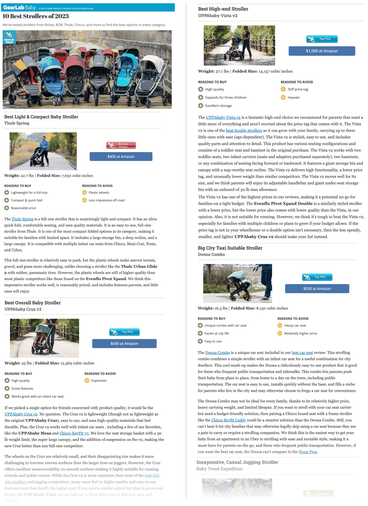

## Appendix B Study 1 Details

### B.1. Example web pages

Below in Figure 5, we show a partial snapshot of a representative comparison article on the topic of “best baby strollers.”

Figure 5. 
Example comparison article on the topic of “best baby strollers.” Note that it only contains approximately $1/4$ of the article, which originally includes content about 10 baby strollers, along with other long-form commentaries. The article can be found online at https://www.babygearlab.com/topics/getting-around/best-stroller.

### B.2. Dataset of Groundtruth Criteria vs Selenite-retrieved Criteria
