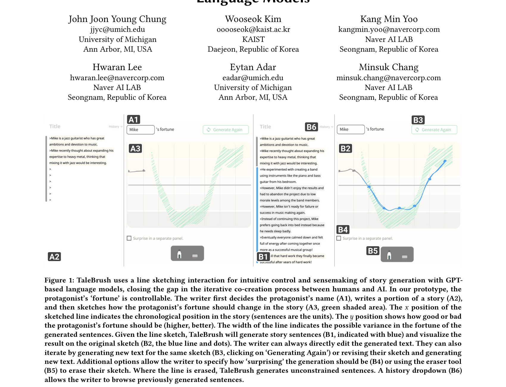

# **TaleBrush: Sketching Stories with Generative Pretrained** **Language Models**

John Joon Young Chung
jjyc@umich.edu
University of Michigan
Ann Arbor, MI, USA

Hwaran Lee

hwaran.lee@navercorp.com
Naver AI LAB

Seongnam, Republic of Korea

Wooseok Kim

ooooseok@kaist.ac.kr

KAIST

Daejeon, Republic of Korea

Eytan Adar
eadar@umich.edu
University of Michigan
Ann Arbor, MI, USA

Kang Min Yoo
kangmin.yoo@navercorp.com
Naver AI LAB

Seongnam, Republic of Korea

Minsuk Chang
minsuk.chang@navercorp.com
Naver AI LAB

Seongnam, Republic of Korea

**Figure 1: TaleBrush uses a line sketching interaction for intuitive control and sensemaking of story generation with GPT-**
**based language models, closing the gap in the iterative co-creation process between humans and AI. In our prototype, the**
**protagonist’s ‘fortune’ is controllable. The writer first decides the protagonist’s name (A1), writes a portion of a story (A2),**
**and then sketches how the protagonist’s fortune should change in the story (A3, green shaded area). The** 𝑥 **position of the**
**sketched line indicates the chronological position in the story (sentences are the units). The** 𝑦 **position shows how good or bad**
**the protagonist’s fortune should be (higher, better). The width of the line indicates the possible variance in the fortune of the**
**generated sentences. Given the line sketch, TaleBrush will generate story sentences (B1, indicated with blue) and visualize the**
**result on the original sketch (B2, the blue line and dots). The writer can always directly edit the generated text. They can also**
**iterate by generating new text for the same sketch (B3, clicking on ‘Generating Again’) or revising their sketch and generating**
**new text. Additional options allow the writer to specify how ‘surprising’ the generation should be (B4) or using the eraser tool**
**(B5) to erase their sketch. Where the line is erased, TaleBrush generates unconstrained sentences. A history dropdown (B6)**
**allows the writer to browse previously generated sentences.**
