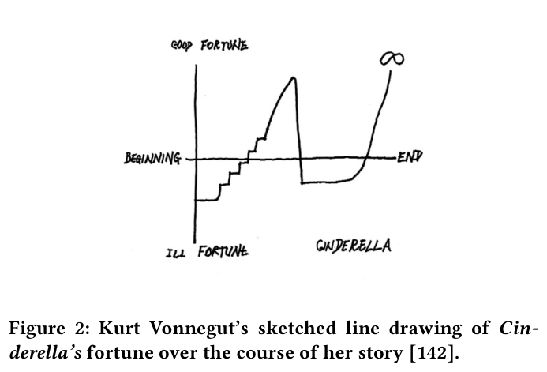

**1** **INTRODUCTION**

Advances in pretrained generative language models, such as Open
AI’s GPT-3 [ 119 ], have enabled new kinds of human-AI story cocreation tools [24, 27ś29, 61, 62]. In many of these tools, the story
co-creation process is iterative [ 24, 28, 29, 51, 143 ]: first, a writer
gives the initial story sentences, such as łMelissa fought a dragon.ž
Then, using the writer’s sentence as a prompt, the AI tool appends
story sentences or phrases. For example, the tool can generate: łShe
used magic to create a barrier around her.ž The writer can modify
the story directly, start from scratch, hoping for better results, or
continue the iterative process by adding another sentence.
However, consider a case where the writer has some idea of how
the story should unfold. They would like to build tension for Melissa
by giving her some bad luck with the dragon and only in the end
boost her fortune. Unfortunately, steering the text generation in this
way is hard both from the algorithmic and interaction perspective.
First, most controlled story generation algorithms, which can be
guided with inputs like topical keywords, apply the same control to
the whole generated story. However, as the writer wanted Melissa
to experience bad luck first and then end up with a happy ending,
they would need to specify different parameters to different parts
of the story. Such granular sequence control is not yet possible in
many controlled story generation algorithms. Second, even when
the generation algorithm allows such granular sequence control,
existing interfaces (e.g., text inputs or sliders) are not intuitive or
useful for controlling or sensemaking in the generative process. For
example, when there is a series of granular controls (e.g., sliders),
specifying them can be cumbersome (e.g., inputting multiple numerical control values). Sensemaking, or understanding what the
algorithm will do, or has done, is similarly difficult. To understand
if the generated story follows the given parameters, writers have to
compare each generated story part with each granular parameter.
These frictions make iterative co-creation slow and effortful.

**Figure 2: Kurt Vonnegut’s sketched line drawing of Cin-**
**derella’s fortune over the course of her story [142].**

In this work, we propose that visual sketching interactions can
facilitate granular sequence control and sensemaking in iterative
story generation. Sequential properties of stories have frequently
been visually expressed for intuitive understanding or planning [ 59,
71, 79, 92, 118, 121, 137, 138, 142 ]. For example, Kurt Vonnegut [ 142 ]
drew out how a character’s fortune changes in a simple time-series
line drawing (Figure 2). This line drawing approach has inspired
writers to adopt visual arcs to plan out their stories [34, 100, 122].
With this visualization as inspiration we created TaleBrush (Figure 1). TaleBrush is focused on human and AI co-writing short story
outlines by allowing writers to control the generation according
to the level of fortune the protagonist experiences [ 34, 121, 142 ].
Writers can specify the sequence of a character’s fortune with a
simple and expressive interaction (Figure 1A3). Using a single stroke
(simple), the writer defines the fortune over the entire protagonist’s
‘time-series’ (expressive). The sentences generated by TaleBrush are
reflected back to the user as a line drawn on top of the original
sketch (Figure 1B2). The lightweight and intentionally ambiguous
nature of sketching [ 49, 84 ] manages the writer’s expectation regarding the fidelity of control, making uncertainties and errors
in controllability acceptable. To realize this interaction, we implemented a technical architecture that achieves steerable story
generation by training 1) learnable prompts that guide a language
model to serve different story generation tasks [ 87 ] and 2) a control
module that steers the language model to generate stories according
to the given sketch [83].
We conducted a technical evaluation of TaleBrush and found that

our approach can reliably steer generations that are still novel and
tolerably coherent in flow and grammar. From a user study on 14
participants with varying expertise in story writing, we found that
participants could use the sketching control to iteratively steer the
generation to find inspiring stories that align with their intentions
about the protagonist’s fortune. Some participants also used line
sketches as a plan when editing the generated texts. In our discussion section, we lay out the design elements for interactions that
facilitate iterative human-AI co-creation. We also reflect on how
visual sketching interactions can be extended to other story-writing
attributes and domains while supporting reliable steerability even
under the uncertainty of machine learning algorithms. This work

TaleBrush: Sketching Stories with Generative Pretrained Language Models CHI ’22, April 29-May 5, 2022, New Orleans, LA, USA

opens up a way of using visual controls and visualizations to make
iterative human-AI co-creation intuitive and frictionless.

To summarize, our work contributes: 1) A line sketching interaction for control and sensemaking of story generation with an
abstract graphical representation of sequential attributes. 2) A GPTbased controllable language model architecture that generates story
sentences with the sketching input on the protagonist’s fortune. 3)
TaleBrush, a system that enables human-AI story co-creation with
the protagonist’s fortune arc by combining line sketching interaction with GPT-based controllable language model. 4) Reflections on
generalizable design elements of control interaction for iterative
human-AI co-creation and how line sketching interaction can be
expanded to other generative contexts.
