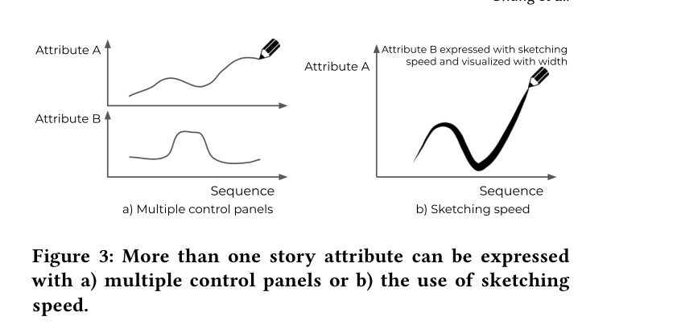

**3** **SKETCHING SEQUENCE CONTROL**

Though narratives may not be linear, stories are inherently formed
in a sequence, progressing from the story beginning to the ending.
Within that sequence, attributes of the story or characters (e.g., the

**Figure 3: More than one story attribute can be expressed**
**with a) multiple control panels or b) the use of sketching**
**speed.**

protagonist’s fortune) can change. Our goal is to allow the user
to use these attributes to guide the generated sequence. Specifically, we seek a lightweight mechanism to quickly specify multiple
temporally-varying attributes. In this work, we consider line sketching interaction as the modality. There are a number of features of
this interaction modality that make the approach appropriate. First,
line sketching in time series visualization can be expressive enough
to convey sequence and attribute information [ 1, 106 ]. For example, in Figure 2, the sequence can be shown on the 𝑥 -axis while
expressing the protagonist’s fortune on the 𝑦 -axis. Second, line
sketches are simple. In Figure 2, the protagonist’s fortune is expressed just in a single stroke of a line. Though we could build a
similar time series through sliders, text entry of coordinates into a
spreadsheet or clicking on points, a drawn line in a time-series is
lightweight and intuitively understood. This design is well suited
for continuous values (e.g., the fortune level). However, one could
imagine ‘sketching’ discrete/categorical values as well by drawing
disconnected horizontal lines. By default, a simple swipe can allow
the author to indicate the attribute, for how long it should last, and
where in the story it should exist.
While **sequence** can be expressed in various ways, we choose to
use the familiar linear 𝑥 position (with attribute values on the 𝑦 ). Linear positions have been most frequently used to visualize sequence
and it can promote accurate perceptual judgment of time [ 1, 18 ].
Rotated (e.g., clock) or spiral-format temporal representations are
also possible [ 149 ] but are best suited for representing cycles or
seasonality in temporal dataÐsomething uncommon in stories.
In some cases, we may want to express **multiple story at-**
**tributes** . For example, the user might want to specify two characters’ fortunes. In this situation, the multiple time series can either
be sketched within the same 𝑥 − 𝑦 space (assuming the scales are
the same) or drawn in multiple spaces (e.g., Figure 3a). To draw
two attributes (along with time) in a single plot is possible but
requires additional encodings. For example, a connected scatterplot
(see [ 52 ]) draws the values for the two attributes on the 𝑥 and 𝑦
axes respectively with time encoded using marks on the lines themselves (e.g., arrows or graduated thickness) that indicates sequence.
One could also imagine using a feature of the sketching interaction
(e.g., pressure or the time it takes to draw a segment) to encode
values. For example, in Figure 3b, time is displayed on the 𝑥 -axis,
the value for attribute 𝐴 on the 𝑦 -axis and the time used to draw
the stroke (or pressure) to encode the 𝐵 attribute (visually these can
be encoded using stroke size or color). Drawing speed is naturally
combined with stroked lines and allows for a semantic connection

TaleBrush: Sketching Stories with Generative Pretrained Language Models CHI ’22, April 29-May 5, 2022, New Orleans, LA, USA

between fast-slow drawing speeds, and high-low attribute values.
Additionally, users may have ambiguous perceptions of speed and
time [ 116 ]. This might further the idea that the generated story will
only roughly follow the input. Ultimately, this encoding is likely
inappropriate. It still limits us to two attributes and is likely complex and discordant as two similar variables (i.e., attributes 𝐴 and
𝐵) are created and visualized in two different ways.
A potentially better use of the drawing speed (or pen pressure)
is to convey **ambiguity and error-tolerance** . In most cases, a
generative algorithm will not be able to generate a sentence that
precisely matches the attribute value. This is due to two factors.
First, is the randomness in the generation (i.e., we may not be
able to generate a sentence with a character’s fortune at exactly
0.58). Second, is the inherent noise in any classifier that judges
attribute values based on the text. By using ‘sketchiness,’ we are
already conveying some level of ambiguity. However, it would be
ideal to allow the end-user to be able to indicate how accurately
they want the generated sentence to map to their sketch. To allow
this specification, sketch speed or pen pressure may useful. Both
actions have a natural mapping to ‘dropping more ink’ in natural
pen interactions. The size of the sketched line at a particular time
indicates the desired boundsśsmaller, indicating more constrained.
Notably, the specific semantics of slower motion can be switched.
Drawing slower can be made to produce ‘more ink’ and therefore
higher tolerance. Conversely, people often draw more slowly when
they want an ‘accurate’ shape. Thus, a slower draw speed can
semantically map to a more ‘accurate’ (i.e., tighter/thinner) line
being drawn.
Though there is a fairly broad design space for sketched input, the
combination of interactive controls, representation effectiveness,
and flexibility seem best addressed through simpler representations:
standard time-series for a single attribute and additional panels for
multiple attributes. However, stroke speed or pressure, represented
as line thickness or color, allows us to encode additional information

such as error-tolerance.
