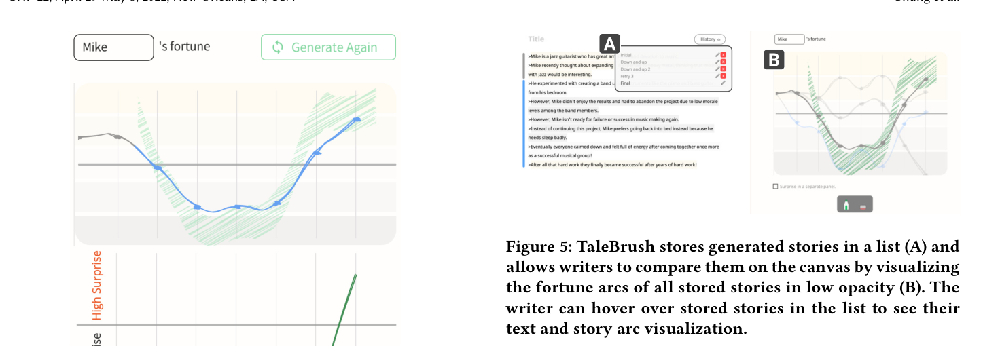
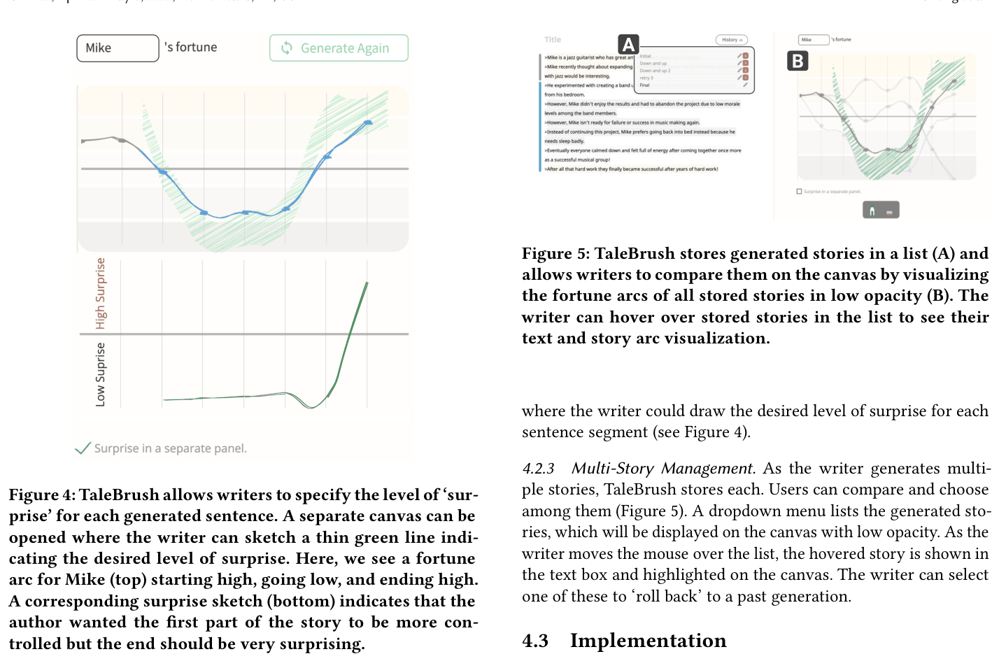

**4** **TALEBRUSH: INTERFACE**

In this section, we motivate our selection of controlled story attributes and explain interactions in TaleBrush’s interface.

**4.1** **Iterative Co-creation With Line Sketching**

TaleBrush is designed to help writers co-create a short storyline
with AI through sketching interactions. TaleBrush supports the
planning stage of the writing process [ 44, 48 ] by giving ideas that
can be novel to writers. We chose to support this specific stage, as
writers would likely accept and benefit from diverging generations.
After a story is generated, writers can freely edit it or even try the
generation again to see another story from TaleBrush. TaleBrush
can support writers who would use generated sentences as writing
prompts, or even potentially help them overcome writer’s block.
For novice writers, TaleBrush would demonstrate a story writing
that would allow them to easily jump into writing.
In TaleBrush, writers iterate on the story generation to reach
the desired state. Through our interactive controls, our goal is to
allow writers to reach this state with a small number of iterations.

As introduced in Section 3, sketching controls (green shaded area

in Figure 1A3 and B2) allow for simple and expressive control interaction. TaleBrush visualizes generated stories in the same abstract
visualization (blue line in Figure 1B2). Through this, writers can
more easily understand the relation of their input to the generated content. We believe that the intuitiveness of these natural

controls and visualizations will ultimately allow writers to more
easily iterate on the story generation.
In our initial implementation, TaleBrush specifically focuses on
two controllable attributes. The first is **the level of the protag-**
**onist’s fortune** . This is based on the existing practice of writers
expressing and planning stories based on character or emotional
arcs [ 34, 150 ] or more generally on a character’s fortune [ 142 ]. TaleBrush is designed to allow the control of the protagonist’s fortune
in chronological order. Non-linear narratives, such as flashbacks,
are not currently supported. The user can also specify how tightly
TaleBrush would follow these given fortune parameters at the cost
of generation time. The second attribute is **the level of surprise**
in the generation, or how unexpected the generation should be.

**4.2** **Interface**

4.2.1 Text Editor and Canvas. TaleBrush has a text editor (Figure 1A2 and B1) and a canvas for drawing and visualizing the story
arc (Figure 1A3 and B2). The text editor has multiple ‘bullet points’,
each of which stands for a single sequence step, most often a sentence. The writer can add their own sequence sentences or ask
TaleBrush to generate them. As with a standard editor, the writer
can add new sequence sentences (simply by hitting enter), or remove them by deleting the bullet point line. TaleBrush will visualize
each bullet point line as a dot in the canvas and sequential dots
will be graphically connected with lines. Thus, there is a correspondence between bullet point order and 𝑥 position of those sentences
in the visualization. Missing sentences (i.e., blank bullet points) are
reflected with a visual gap. The protagonist’s fortune in a given
sentence is determined by an ML recognition algorithm.

4.2.2 Generate By Sketching. After the writer sketches a character’s fortune (as described in Section 3), TaleBrush generates text
for those sentences for łsketchedž sentence slots. For example, the
writer can enter one or two sentences, for which the fortune is
calculated and displayed. They can then sketch the rest of the sequence. TaleBrush also supports ‘infilling’ the story. For example,
if the writer enters a sentence at the start and end of the sentence

list, this will appear as a broken line in the visualization. The writer
can sketch how they want the story to behave in this empty part
and TaleBrush will create suitable sentences. The writer can also
draw ‘broken’ lines by erasing part of the sketched line. In this
mode, TaleBrush will generate a suitable sentence but without any
specific fortune ‘target.’ This allows writers to explore stories even
when they do not have a specific idea on what the character’s
fortune should do. Once the sketch is drawn, the writer can perform generation again with the same parameters by clicking the
łGenerate Againž button (Figure 1B3). They can also redraw a line
only on a part of the sequence to see other generated sentences on
the redrawn part. In all cases, the writer also can revise generated
sentences directly in the text editor.

CHI ’22, April 29-May 5, 2022, New Orleans, LA, USA Chung et al.

**Figure 5: TaleBrush stores generated stories in a list (A) and**
**allows writers to compare them on the canvas by visualizing**
**the fortune arcs of all stored stories in low opacity (B). The**
**writer can hover over stored stories in the list to see their**

**text and story arc visualization.**

where the writer could draw the desired level of surprise for each
sentence segment (see Figure 4).

**Figure 4: TaleBrush allows writers to specify the level of ‘sur-**
**prise’ for each generated sentence. A separate canvas can be**
**opened where the writer can sketch a thin green line indi-**
**cating the desired level of surprise. Here, we see a fortune**
**arc for Mike (top) starting high, going low, and ending high.**
**A corresponding surprise sketch (bottom) indicates that the**
**author wanted the first part of the story to be more con-**
**trolled but the end should be very surprising.**

Sketching Speed for Generation Control Tightness. As the controlled generation has uncertainty in how the control would apply,
with the sketching speed, the writer can set how closely generated
sentences should follow the given sketch. With slow sketching,
TaleBrush tries more generations to find the sentence that better
matches the given fortune parameter. In our experience, we found
that the fast → less accurate and slow → more accurate mappings
were easier to understand. The drawn sketch can be perceived as
an ‘envelope’ representing the bounds in which the generated sentences would be more likely to fall (Figure 1A3 and B2). We detail
how the specific width is determined in Section 6. The width of
the sketched line gradually changes visually (i.e., it is not disjoint).
This is more appealing visually. However, the actual envelope is
determined using sentence ‘units.’ Subtle vertical lines indicated
where these transitions are, thus allowing the user to vary their
drawing speed in each segment.

Surprise Level Control. As we describe below, the specific language model we used also allowed us to change parameters that
roughly translated to how ‘surprising’ a sentence would be in the
following prior sentences. For example, with the beginning sentence of łMelissa fought a dragonž, the low surprise may generate
łThe dragon was a big, green, scaly beastž, but the high surprise
may result in łMelissa killed a giant robot with a robot dragonž. To
experiment with this feature, we added a łsurprise in a separate
panelž control. This would open up another time series canvas

4.2.3 Multi-Story Management. As the writer generates multiple stories, TaleBrush stores each. Users can compare and choose
among them (Figure 5). A dropdown menu lists the generated stories, which will be displayed on the canvas with low opacity. As the
writer moves the mouse over the list, the hovered story is shown in
the text box and highlighted on the canvas. The writer can select
one of these to ‘roll back’ to a past generation.

**4.3** **Implementation**

The interface for TaleBrush is implemented as a web application,
using HTML, CSS, JavaScript, and React. The language model operations for text generation are implemented in a back-end server. A
Flask-based REST API is used to connect the frontś and backśend

sub-systems.
