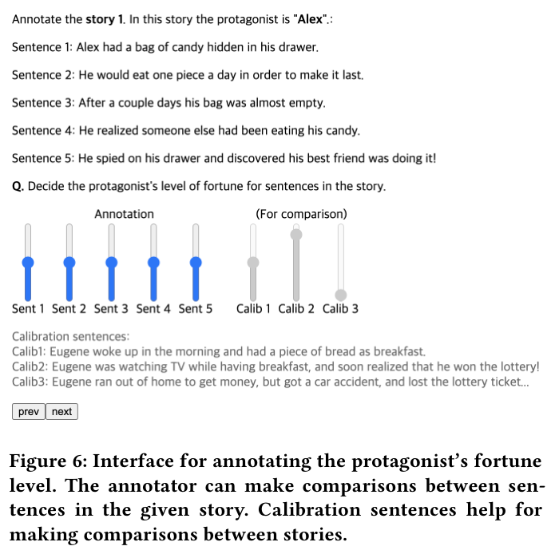
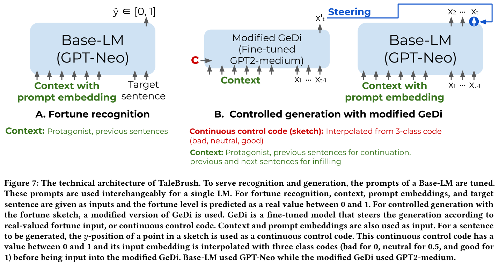
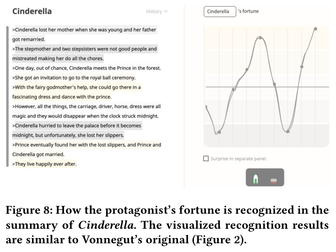
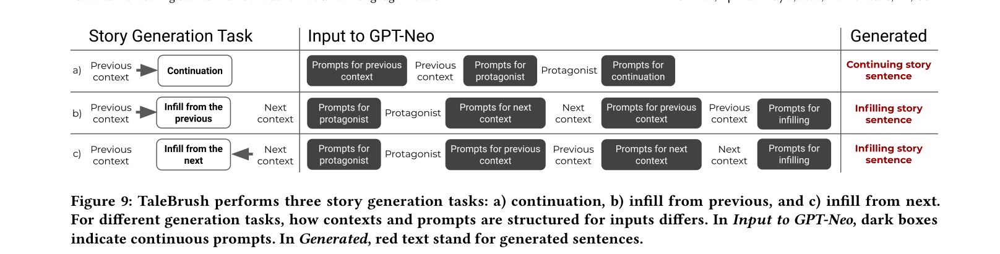
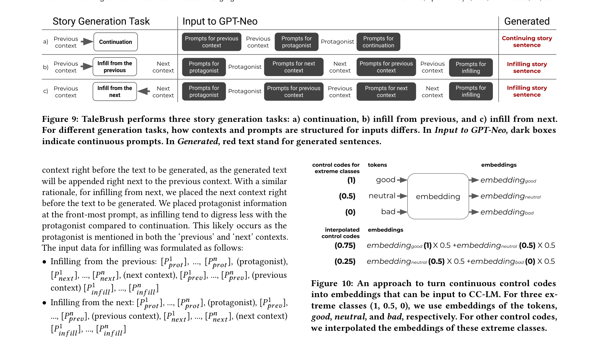

**5** **TALEBRUSH: TECHNICAL DETAILS**

There are two principle technical components to TaleBrush: sentence **recognition**, which determines a fortune level given an input
sentence; and sentence **generation**, which creates new sentences.
We begin by explaining our annotated training data, and then cover
each of recognition and generation modules.

**5.1** **Collecting Fortune of the Protagonist**

We adopted crowdsourcing to create an annotated fortune dataset,
as there is no readily available data of this type. We define the
protagonist’s fortune as level of ‘goodness’ or ‘badness’ of the fortune
experienced by the protagonist, as perceived by the readers. This construct is naturally affected by the character’s status, emotional and
physical well-being, or spatial, mental, and emotional proximity to
the character’s goal [ 34 ]. While line sketching interaction would
require fortune annotations to be real values, due to the subjectivity
in perceiving this concept, directly collecting real-valued annotations can result in a high variance. As people can make comparisons
reliably on subjective annotations [ 33, 68 ], we took the approach
similar to previous work’s [ 33 ]: turning crowdsourced comparisons
into real-valued annotations.

TaleBrush: Sketching Stories with Generative Pretrained Language Models CHI ’22, April 29-May 5, 2022, New Orleans, LA, USA

To turn comparisons into real-valued labels, we used the TrueSkill
algorithm [ 33, 56, 102 ]. The algorithm can calculate the real-valued
fortune score of each sentence out of all comparisons from our
crowdsourced annotations. While this algorithm is originally designed to infer rankings of game players out of all individual game
results, like who won or lost, we adapted it to get rankings of
fortunes out of all comparison annotations. With this algorithm,
sentences frequently annotated to have a higher fortune than other
sentences would have a high fortune ranking. We normalized this
ranking information to have a uniformly distributed dataset on the
scale of 0 to 1 and used the resulting annotations.

**5.2** **Technical Architecture**

A high level architecture for the recognition and generation elements of TaleBrush is depicted in Figure 7.

**Figure 6: Interface for annotating the protagonist’s fortune**
**level. The annotator can make comparisons between sen-**
**tences in the given story. Calibration sentences help for**
**making comparisons between stories.**

We collected fortune annotations on a subset of the ROCStories
dataset [ 105 ]. Items in this dataset are short five-sentence stories.
We randomly sampled 2200 stories, using 2000 for training and 200
as a test set. We assigned three annotators for each story. During
data collection, we explicitly specified the protagonist of the story.
Annotators were asked to specify the level of the protagonist’s fortune for each sentence using a continuous slider (Figure 6). While
this annotation approach is mainly designed to collect real-valued
annotations, the interface also enables annotators to encode comparisons between sentences. Workers were not explicitly asked to
compare sentences between different stories. However, they were
asked to annotate using the łcalibrating sentencesž as benchmarks.
One of the authors crafted these calibrating sentences from a threesentence story to ensure a unique, single-sentence example for
three fortune ‘types’: good, bad, and neutral. Our annotators were
asked to label these calibrating sentences at the start of the task
and could see them as they worked (see Figure 6).
To ensure high annotation quality, we included one gold standard question with sentences of obvious good and bad fortunes. We
filtered out workers who annotated such questions in opposite fortune directions. We recruited annotators from Amazon Mechanical

Turk, who are in the US and had 97% acceptance rate with 1000 or
more accepted tasks. Each worker was asked to annotate 11 stories
including the calibrating story and was paid $2.50 (about $10/hr
payment rate).
To learn the reliability of annotations, we analyzed agreements
between pairs of annotators. We measured Spearman’s 𝜌 in ranking five sentences in a story according to the fortune level (i.e.,
with perfect agreement 𝜌 `=` 1 or − 1 with perfect disagreement).
The average and median of 𝜌 values between pairs were 0.54 and
0.7, respectively. Though clearly imperfect, annotators did display
agreement in their annotations.

5.2.1 Recognition Module. TaleBrush recognizes the protagonist’s
fortune to map sentences in the visualization. To match the training
dataset for the recognition and controlled generation, we trained
our own recognition model. Specifically, we use prompting approaches of GPT-based models [ 21, 119 ]. For instance, to recognize
the protagonist’s fortune, to the model, we can input the prompt łEstimate fortune:ž with the subject sentence appended to it. However,
hand-designing optimal prompts is known to be challenging [ 87, 93 ].
Hence, we used the soft prompt approach [ 87, 88, 93 ], which learns
these prompts on the continuous input embedding space. These
soft prompts replace łdiscretež natural language prompts. In other
words, we can replace łEstimate fortune:ž with several learnable soft
prompt embeddings. We took the soft prompt tuning approach [ 87 ]
instead of fine-tuning the whole parameters of the LM, as trained
soft prompts require less memory (about × 10 [5] less size than the
whole parameters). Fine-tuning multiple whole-parameter models
for multiple tasks (e.g., generation), would require significantly
more computation resources.
We trained the soft prompts to minimize the regression loss
on the protagonist’s fortune label of an estimated sentence. As a
language model, we used a GPT-Neo [ 13 ], which is a GPT-based
auto-regressive model [ 21, 119 ] with 2.7 billion parameters. We
included the context sentences previous to the target sentence in
the input data, as they can have critical information. This previous
context includes, at maximum, three sentences. We picked three
as it had the smallest loss in the test dataset. We also included the

protagonist’s name in the context. The input and output labels are
formatted as follows:

- Input: [ 𝑃 𝑝𝑟𝑒𝑣 [1] ], ..., [ 𝑃 𝑝𝑟𝑒𝑣 [𝑛] ], (previous context), [ 𝑃 𝑝𝑟𝑜𝑡 [1] [], ..., [] [𝑃] 𝑝𝑟𝑜𝑡 [𝑛] [],]
(protagonist), [𝑃 𝑡𝑎𝑟 [1] [], ..., [][𝑃] 𝑡𝑎𝑟 [𝑛] [], (target sentence)]

- Label: 𝑦 ∈[0, 1]

[ 𝑃 𝑟 [𝑖] ] stands for the placeholder for soft prompt embeddings, with
𝑟 and 𝑖 indicating the role and the index of soft prompts, respectively.
For each prompt role, we chose three prompt tokens ( 𝑛 `=` 3) which
fit with that of initialization prompts we used (‘Previous Context:’
for 𝑃 𝑝𝑟𝑒𝑣, ‘Protagonist:’ for 𝑃 𝑝𝑟𝑜𝑡, and ‘Sentence:’ for 𝑃 𝑡𝑎𝑟 ). With
trained prompts, we could recognize the protagonist’s fortune, as
demonstrated on Cinderella in Figure 8.

5.2.2 Generation Module. Our goal is for TaleBrush’s generation to
be steerable with a sequence of fortune values. For this, we modified

CHI ’22, April 29-May 5, 2022, New Orleans, LA, USA Chung et al.

**Figure 7: The technical architecture of TaleBrush. To serve recognition and generation, the prompts of a Base-LM are tuned.**
**These prompts are used interchangeably for a single LM. For fortune recognition, context, prompt embeddings, and target**
**sentence are given as inputs and the fortune level is predicted as a real value between 0 and 1. For controlled generation with**
**the fortune sketch, a modified version of GeDi is used. GeDi is a fine-tuned model that steers the generation according to**
**real-valued fortune input, or continuous control code. Context and prompt embeddings are also used as input. For a sentence**
**to be generated, the** 𝑦 **-position of a point in a sketch is used as a continuous control code. This continuous control code has a**
**value between 0 and 1 and its input embedding is interpolated with three class codes (bad for 0, neutral for 0.5, and good for**
**1) before being input into the modified GeDi. Base-LM used GPT-Neo while the modified GeDi used GPT2-medium.**

can also calculate the probability for the token that comes after the
lastly sampled token.

**Figure 8: How the protagonist’s fortune is recognized in the**
**summary of Cinderella. The visualized recognition results**
**are similar to Vonnegut’s original (Figure 2).**

the approach used in GeDi [ 83 ], which uses a fine-tuned smaller
model to guide a bigger language model with a control input. In
order to explain the details of our GeDi variant, we first describe
how generation can be done with LMs. Then, we describe our base
LM that serves story generation tasks and GeDi model that steers
stories with the control code.

Generation with Language Model. When an auto-regressive LM
receives a sequence of tokens ( 𝑥 1:𝑇 `=` {𝑥 1, . . .,𝑥 𝑇 } ), it calculates
the probabilities for the next tokens with a chain rule ( 𝑃 𝜃 (𝑥 1:𝑇 ) `=`
`�` 𝑇𝑡 `=` 1 [𝑃] [𝜃] [(][𝑥] [𝑡] [|][𝑥] `[<]` [𝑡] [)] [). With this probability, we can sample out the next]
likely token. By inputting the sampled token back into the LM, we

Base Language Model for Story Generation. As a base LM for
language generation, TaleBrush uses the same GPT-Neo the recognition module uses. However, different soft prompt embeddings
are trained for the generation tasks. The benefit is that one large
pre-trained LM can be utilized for different tasks just by replacing
prompts and contexts according to the task purpose. We trained
soft prompts for story continuation and infilling. For continuation
(Figure 9a), the previous context and protagonist are fed into the
language model as input and the model generates the continuing
sentences. We appended the character information as models without character information tend to introduce random characters. We

placed the character information right before the text to be generated, to make it more likely that character information is considered
during the continuing generation. Accordingly, the input data is
formulated as the following:

- Continuation: [ 𝑃 𝑝𝑟𝑒𝑣 [1] ], ..., [ 𝑃 𝑝𝑟𝑒𝑣 [𝑛] ], (previous context), [ 𝑃 𝑝𝑟𝑜𝑡 [1] [], ...,]

[𝑃 𝑝𝑟𝑜𝑡 [𝑛] [], (protagonist), [][𝑃] 𝑐𝑜𝑛𝑡 [1] [], ..., [][𝑃] 𝑐𝑜𝑛𝑡 [𝑛] []]

Similar to recognition prompts, we chose the number of prompts
that matches the initializing prompt ( 𝑛 `=` 3 with ‘Beginning Story:’
for 𝑃 𝑝𝑟𝑒𝑣, ‘Story Character:’ for 𝑃 𝑝𝑟𝑜𝑡, and ‘Continue Story:’for
𝑃 𝑐𝑜𝑛𝑡 ).
For infilling (Figure 9b and c), we included both the previous and
next contexts and the protagonist as the model input. We trained
two types of prompts for infilling: one for filling after the previous
context, and the other for filling backward from the next context.
When running infilling generation, these two prompts are used in
turn, switching from one to the other for every generated infilling
sentence. For infilling from the previous, we placed the previous

TaleBrush: Sketching Stories with Generative Pretrained Language Models CHI ’22, April 29-May 5, 2022, New Orleans, LA, USA

**Figure 9: TaleBrush performs three story generation tasks: a) continuation, b) infill from previous, and c) infill from next.**
**For different generation tasks, how contexts and prompts are structured for inputs differs. In Input to GPT-Neo, dark boxes**
**indicate continuous prompts. In Generated, red text stand for generated sentences.**

context right before the text to be generated, as the generated text
will be appended right next to the previous context. With a similar
rationale, for infilling from next, we placed the next context right
before the text to be generated. We placed protagonist information
at the front-most prompt, as infilling tend to digress less with the
protagonist compared to continuation. This likely occurs as the
protagonist is mentioned in both the ‘previous’ and ‘next’ contexts.
The input data for infilling was formulated as follows:

- Infilling from the previous: [ 𝑃 𝑝𝑟𝑜𝑡 [1] [], ..., [] [𝑃] 𝑝𝑟𝑜𝑡 [𝑛] [], (protagonist),]

[ 𝑃 𝑛𝑒𝑥𝑡 [1] [], ..., [] [𝑃] 𝑛𝑒𝑥𝑡 [𝑛] [], (next context), [] [𝑃] 𝑝𝑟𝑒𝑣 [1] [], ..., [] [𝑃] 𝑝𝑟𝑒𝑣 [𝑛] [], (previous]
context) [𝑃 [1]
𝑖𝑛𝑓𝑖𝑙𝑙 [], ..., [][𝑃] 𝑖𝑛𝑓𝑖𝑙𝑙 [𝑛] []]

- Infilling from the next: [ 𝑃 𝑝𝑟𝑜𝑡 [1] [], ..., [] [𝑃] 𝑝𝑟𝑜𝑡 [𝑛] [], (protagonist), [] [𝑃] 𝑝𝑟𝑒𝑣 [1] [],]
..., [ 𝑃 𝑝𝑟𝑒𝑣 [𝑛] ], (previous context), [ 𝑃 𝑛𝑒𝑥𝑡 [1] [], ..., [] [𝑃] 𝑛𝑒𝑥𝑡 [𝑛] [], (next context)]

[𝑃 [1]
𝑖𝑛𝑓𝑖𝑙𝑙 [], ..., [][𝑃] 𝑖𝑛𝑓𝑖𝑙𝑙 [𝑛] []]

We chose the number of prompts according to that of the initializing prompt. ( 𝑛 `=` 3 with ‘Story Character:’ for 𝑃 𝑝𝑟𝑜𝑡, ‘Beginning
Story:’ for 𝑃 𝑝𝑟𝑒𝑣, and ‘Ending Story:’ for 𝑃 𝑛𝑒𝑥𝑡, and 𝑛 `=` 4 with
‘Infilled Story:’ for 𝑃 𝑖𝑛𝑓𝑖𝑙𝑙 ).

Controlling Generation with GeDi. TaleBrush adopts the GeDi
approach. This model guides an LM model (base LM) with a smaller
Class-conditional LM (CC-LM) that is fine-tuned to generate using
a user-specified control code (e.g., generate a happy story with the
control code of łgoodž). Similar to standard LMs, CC-LM calculates
the probability of the next token given a sequence of tokens. However, it also considers a specific control code ( 𝑐 ) given to the CC-LM
( 𝑃 𝜃 (𝑥 1:𝑇 |𝑐) `=` `[�]` [𝑇] 𝑡 `=` 1 [𝑃] [𝜃] [(][𝑥] [𝑡] [|][𝑥] `[<]` [𝑡,𝑐] [)] [). With CC-LM’s probabilities for]
different codes and the Bayes rule, we also can calculate the probability of each sequence of tokens being classified into a control
code:

𝑃 (𝑐)𝑃 𝜃 (𝑥 1:𝑡 |𝑐) [𝛼][/][𝑡]
𝑃 𝜃 (𝑐 |𝑥 1:𝑡 ) `=` (1)

`Σ` 𝑐 ′ ∈{𝑐,𝑐¯} 𝑃 (𝑐 [′] )𝑃 𝜃 (𝑥 1:𝑡 |𝑐 [′] ) [𝛼][/][𝑡] [,]

where 𝛼 is a learnable scale parameter and ¯𝑐 is codes other than the
selected one. This probability can be combined with that of base
LMs, to decide which token would lead to the coherent story that
follows the control code:

𝑃 𝜔 (𝑥 𝑡 |𝑥 `<` 𝑡,𝑐) ∝ 𝑃 𝐿𝑀 (𝑥 𝑡 |𝑥 `<` 𝑡 )𝑃 𝜃 (𝑐 |𝑥 𝑡,𝑥 `<` 𝑡 ) [𝜔] (2)

Note that 𝜔 serves as a parameter that decides how much steering
will be done with GeDi (higher → more steering). GeDi is faster
than other control approaches that directly manipulate weights [ 31 ]

**Figure 10: An approach to turn continuous control codes**
**into embeddings that can be input to CC-LM. For three ex-**
**treme classes (1, 0.5, 0), we use embeddings of the tokens,**
**good, neutral, and bad, respectively. For other control codes,**
**we interpolated the embeddings of these extreme classes.**

or that filter from many generated texts. Thus it is better suited for
interactive applications.

Modified GeDi for Continuous-Value Control. We modified GeDi
to control generation with continuous-valued control codes. To
enable continuous control between good and bad fortunes, we interpolated between extreme fortune classes. We first trained CC-LM
with three topic classes, each mapping to extremely bad fortune,
neutral fortune, and extremely good fortune. When training the CCLM with these three classes, we took the multi-class topic control
approach introduced in GeDi [ 83 ]. With this approach, the given
łmainž codes are true and false, while three classes of bad, neutral,
and good are given as the secondary codes. When given true, CCLM trains to generate texts according to the given secondary code,
and with false, CC-LM would not follow the secondary code. We
adopted this multi-class topic control approach as it has benefit in
computation time, with fewer łmainž control codes to be computed
to get the probability from Equation 1. We also included the protagonist’s name at the beginning of the input as contexts. A part of
training dataset might look like:

  - <true> <good> Protagonist: Mark # Mark was happy to pass
the exam that he wanted to pass.

  - <false> <bad> Protagonist: Mark # Mark was happy to pass
the exam that he wanted to pass.

For the training data, we used only some of the annotations from
our collection: those in the top, middle, and bottom 10% percentile.
That is, we mapped ranges of values to three discrete classes to

CHI ’22, April 29-May 5, 2022, New Orleans, LA, USA Chung et al.

assure we have enough training data. To train this CC-LM, we
fine-tuned the GPT2-medium model. After the CC-LM is trained,
when an arbitrary value between 0 and 1 is used as a code, we
interpolate embeddings between three discrete classes considering
each of them as having 0, 0.5, and 1 (Figure 10). Then, we used
the interpolated embedding as the input embedding. For example,
when the control code is 0.25 (halfway between the bad and neutral
fortunes), we calcualted the weighted sum of the the learned bad
and neutral embeddings with the weight of 0.5 each.
While GeDi steers the generation with the protagonist’s fortune,
it can potentially make errors, producing sentences outside of the
desired fortune level. To handle these errors, we adopted the approach of regenerating sentences if they were significantly out of
the range of the specified code. Specifically, TaleBrush’s recognition
module measures the generated sentence’s level of fortune, and
if it disagrees with the control value, TaleBrush tries to generate
again. We set the threshold of error for regeneration as 0.2 (i.e.,
|𝑦 − 𝑦ˆ| `>` 0 . 2). TaleBrush tries to regenerate the text 1-2 more times.
Again, this is based on the desired ‘closeness’ of the generated fortune to the writer’s intent (as expressed by the speed of the writer’s
drawn stroke). After the maximum number of regeneration has
been tried, TaleBrush picks the generated sentence that has minimal
fortune level error with the given control value. The surprise level
control value is used as the temperature of the softmax function of
the base language model. To implement our architecture, we used
models from Huggingface [12] .
