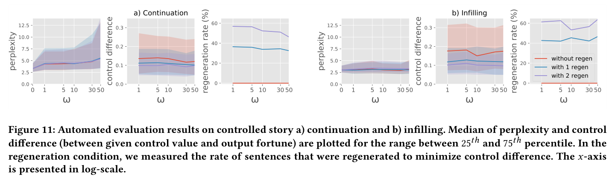

**6** **TECHNICAL EVALUATION**

We conducted technical evaluations on the recognition and generation modules. For recognition, we measured how accurately a
character’s fortune is recognized in a sentence. For the generation
module, we focused on how controllability impacts other qualities
of the story. Controllability is known to have trade-offs with some
story qualities like coherence [ 90 ]. Ideally, our control approach
would allow the writer to steer the generation without hurting
other metrics. We conducted three evaluations: 1) recognition performance, 2) an automated evaluation on generation, to find the
parameter that can achieve the ‘sweet spot’ between controllability
and coherence, and 3) human evaluation on generation, to show
that our approach allows controllability while maintaining other
story qualities.

**6.1** **Fortune Recognition Evaluation**

To evaluate the recognition module, we focused on recognition
error, the difference between the recognized fortune value and the
gold standard labels. This was done on the 200 annotated examples
reserved for testing. The mean and median errors were 0.179 and
0.159 respectively on a 0 to 1 scale. We considered this result to
be reliable. Concepts similar to fortune, such as sentiment, are
usually measured through an ordinal five-level scale. Human raters
can easily discern concepts with this number of levels [ 133 ]. If
we view the five levels on a 0 to 1 scale, with the assumption of
the uniform interval between levels (which is widely adopted in

1 https://huggingface.co/
2 Code for TaleBrush is shared in https://johnr0.github.io/publications/TaleBrush_
CHI2022.

ML [ 133, 156 ]), then the gap between levels will be 0.25. Our average
error (.179) is below this 0.25 gap so most differences would not be
easily discernible.

**6.2** **Automated Generation Evaluation**

We conducted the automated evaluation to identify the parameter
that balances coherence and controllability. Here, the parameter of
interest is 𝜔 : how intensely the steering control is applied. Past work
has demonstrated that a higher 𝜔 value leads to better controllability, but worse coherence [ 90 ]. As we modified the GeDi approach
to our context, we reinvestigated how 𝜔 impacts coherence and
controllability.
For coherence, we calculated perplexity, which is a measure
of how well a probability model predicts to generate a sequence
of text tokens [ 20 ]. To evaluate the controllability, we measured
the control difference: the difference between an input fortune
value and the estimated fortune level of the text generated. To
estimate the fortune level of generated text, we used our fortune
recognition module. We measured these two metrics with our 200
test data points. For the continuation task, we considered the first
sentence as the initial context and generated four more sentences.
For infilling, we considered the first and the last sentences as the
initial context and generated middle three more sentences. For the
controlled generation, we gave fortune annotations in our test data
as control values and measured perplexity and control difference,
while varying 𝜔 value. Recall that we allow for ‘regenerating’ the
text up to two times to improve the generated text’s fit to the
desired fortune (selecting the best of the generated options). We
also simulated this regeneration up to two times to determine the
impact of this on our metrics.
With controlled continuation (Figure 11a), the perplexity tends
to increase with the increase of 𝜔 . The increases in median and 25 [𝑡ℎ]

percentile were relatively stable compared to that of 75 [𝑡ℎ] percentile.
The control difference tended to decrease very slightly with the
increase of 𝜔 . The regeneration approach tends to decrease not
only the median of control differences but also the 75 [𝑡ℎ] percentile
of control difference by a large amount. Regenerating once (two
stories to pick from) resulted in a 30%-40% increase in generation
time, while regenerating twice (three stories) resulted in a 50%60% increase. The rate of performing regeneration decreased very
slightly with the increase of 𝜔.
With infilling, the change of 𝜔 did not change perplexity much
(Figure 11b). This might be because infilling considers both beginning and end contexts, and would diverge less from the gold
standard sentences. On the other hand, for continuation, as there
is no end context to consider, the generated text can diverge significantly from the gold standard sentences. The control difference
and regeneration rate did not have a discernible trend with changes
to 𝜔 . Without regeneration, the control difference of infilling was
larger than that of continuation. Similar to continuation generation,
the addition of regeneration leads to decreased control difference.
The rate of regeneration was 40%-50% when regenerated once and
50%-65% when regenerated twice, which was higher than those of
the continuation.
From the results, we find that a small 𝜔 value did not hurt controllability much. Moreover, a low 𝜔 value assured low perplexity

TaleBrush: Sketching Stories with Generative Pretrained Language Models CHI ’22, April 29-May 5, 2022, New Orleans, LA, USA

60

40

20

0

1 5 10 30 50

~~0~~

1 5 10 30 50

12.5

10.0

7.5

5.0

2.5

~~0.0~~
0 1 5 10 30 50

without regen

with 1 regen

with 2 regen

12.5

10.0

7.5

5.0

2.5

0.0
0 1 5 10 30 50

a) Continuation

0.3

0.2

0.1

0.0
1 5 10 30 50

b) Infilling

0.3

0.2

0.1

~~0.0~~
1 5 10 30 50

60

40

20

**Figure 11: Automated evaluation results on controlled story a) continuation and b) infilling. Median of perplexity and control**
**difference (between given control value and output fortune) are plotted for the range between** 25 [𝑡ℎ] **and** 75 [𝑡ℎ] **percentile. In the**
**regeneration condition, we measured the rate of sentences that were regenerated to minimize control difference. The** 𝑥 **-axis**
**is presented in log-scale.**

in continuation tasks. If regenerating once, the control difference
decrease at a cost of 30%-50% more generation time. Considering
the findings, in TaleBrush, we use 𝜔 value of 1 and try regeneration
once as a baseline. Recall that we still limit regeneration to at most
twice based on the writer’s input. While additional regeneration
may improve the results, the response time costs may be too high
for an interactive application with the current architecture.

**6.3** **Human Evaluation on Generation**

In addition to the automated test, we conducted a human evaluation to see if stories generated by TaleBrush are perceived as
coherent, novel, and controlled. For controllability, we showed evaluators two sentences generated with two different fortune levels
and asked them to decide in which sentence the protagonist has a
better fortune. Evaluators were not shown the input fortune values.
If an evaluator chose the sentence generated with a higher fortune
control value, we considered the answer correct. All fortune values in the human evaluation were randomly sampled. However,
in the controllability study, we excluded control values that were
too similar (a difference smaller than 0.25), as such similar controls
would be even difficult for humans to differentiate. We decided this
threshold as 0.25 as fortune level differences larger than this value
would be discernible to evaluators (i.e., five-level Likert scales are
frequently used for sentiment annotation). We additionally investigated the novelty of generated texts as TaleBrush is designed to aid
story ideation. We showed evaluators two versions of generated
stories: one ‘with’ controls (i.e., using the GeDi model and character fortune values); and the other without controls (only with
the prompt-tuned GPT-Neo model). We asked the evaluators to
decide which story was more coherent or novel. For coherence, we
specifically asked: 1) if story flow is coherent (story coherence) and
2) if sentences are grammatically coherent (grammaticality). While
there can be more specific incoherent patterns [ 50 ], we chose story
coherence and grammaticality as they each can tell us about the
global and local coherence of the story. Evaluators could choose
one of the generated stories with better coherence or novelty (CX
for łwithout controlsž and CO for łwith controlsž in Figure 12), or
decide that they are similar in quality (S in Figure 12). Evaluators
were not aware of which story is generated with fortune controls.
For each criterion, we evaluated 100 story pairs, 50 for continuation and the other 50 for infilling. When generating these stories,
we applied the regeneration strategy once and used 𝜔 `=` 1. We

hired crowd workers as evaluators, as we wanted to know if even
non-experts in story writing perceive TaleBrush’s generations as
coherent, controlled, and novel. For each assessment question, we
assigned three crowd workers to assure reliable evaluation. We
recruited crowd workers from Amazon Mechanical Turk, who are
in the US, with acceptance rates higher than 97% and more than
1000 tasks accepted. Each worker evaluated one criterion, for eleven
pairs of stories including one gold standard question. We paid them
$3, which is over a $10/hr payment rate.
Figure 12 summarizes our results. Evaluators recognized which
sentence is generated with a higher fortune control value 88.0% of
time for continuation (84.7% for infilling). Stories generated without
fortune controls (CX) were chosen most frequently to have better
story coherence and grammaticality. In continuation, their ratio
was below 50% (45.3% and 46.0% for story coherence and grammaticality, respectively). That is, when using continuation with fortune
controls, in more than half of cases, users would observe stories
with similar (S) or better (CO) story coherence and grammaticality
compared to those generated without controls. With infilling algorithms, similar to continuation, stories generated without controls
(CX) showed better story coherence and grammaticality most frequently, but their frequencies were higher than continuation (62.7%
and 76.7% for story coherence and grammaticality, respectively).
One potential reason for this result might be the fundamental difficulty in generating coherent infilling stories when a given fortune
sequence is not plausible (e.g., drastic fluctuation in fortune). For
novelty, with continuation algorithm, different conditions showed
similar performances. With the infilling algorithm, stories generated with controls (CO) are perceived to be more novel more
frequently. In summary, we found that novelty is not hurt with
fortune controls. We also find that our control approach can steer
the generation according to the control value, but at some cost
to story coherence and grammaticality. The cost is lower in the
continuation algorithm than in infilling one. Regardless of the strategy, no generative algorithm can generate perfect coherence or
grammaticality. Thus, it is critical to ensure that the writer can edit
the final text.
