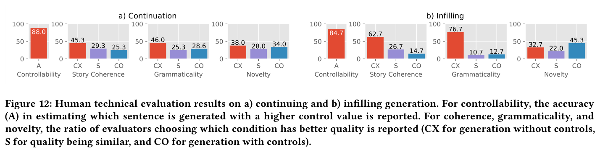
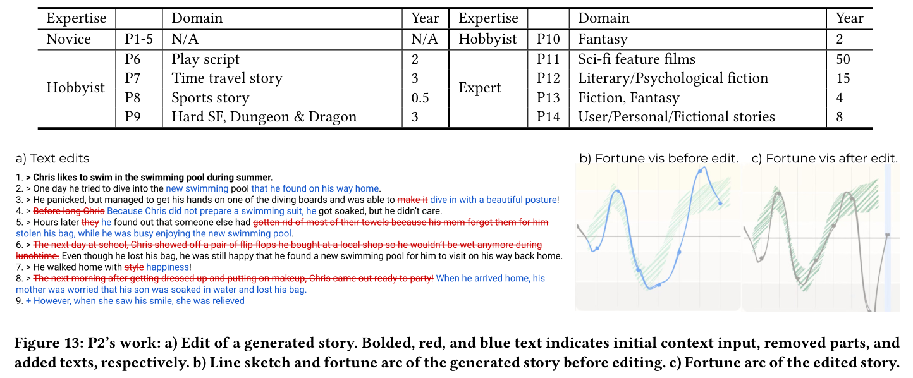

**7** **USER STUDY**

We conducted a user study to gain insights and feedback on the
potential, limitations, and future opportunities of sketching interactions for iterative human-AI story co-creation. We focused on

CHI ’22, April 29-May 5, 2022, New Orleans, LA, USA Chung et al.

100

50

0

~~45.3~~

29.3 25.3

CX S CO

Story Coherence

a) Continuation

100

50

0

~~38.0~~ 28.0 34.0

CX S CO

Novelty

62.7

26.7
14.7

CX S CO

Story Coherence

~~45.3~~
32.7
22.0

CX S CO

Novelty

88.0

100

50

0

84.7

100

50

0

b) Infilling

100

76.7

50

0

100

50

0

~~46.0~~

25.3 28.6

CX S CO

Grammaticality

100

50

0

A

Controllability

10.7 12.7

100

50

0

A

Controllability

CX S CO

Grammaticality

**Figure 12: Human technical evaluation results on a) continuing and b) infilling generation. For controllability, the accuracy**
**(A) in estimating which sentence is generated with a higher control value is reported. For coherence, grammaticality, and**
**novelty, the ratio of evaluators choosing which condition has better quality is reported (CX for generation without controls,**
**S for quality being similar, and CO for generation with controls).**

learning how our novel sketching control facilitates iterative exploration of story ideas and story co-creation. As this study seeks
to understand how users leveraged our novel interactions, we did
not conduct a formal comparison to existing human-AI story cocreation tools.

**7.1** **Participants**

We recruited 14 participants (7 female and 7 male) by word-ofmouth and through online advertisements on social media and
communities of universities. Participants completed a pre-survey
on their background before the study. Our participants had a range
of expertise: novices, hobbyists, and experts. We classified participants who do not write stories occasionally as novices. Others were
classified as either hobbyists or experts, and experts considered
themselves as story-writing professionals. Participants were fluent
in using English. We detailed participants in Table 1.

**7.2** **Procedure**

We conducted a remote study with Zoom [3] . Participants were first
given an overview of the study (15 min), then went through a
tutorial on the tool (15 min). Participants could access TaleBrush
directly through a URL we shared. In the tutorial, we explained that
better fortune was represented with higher points on the 𝑦 -axis.
However, we allowed participants to use the tool to specifically
learn how the mapping worked as there are no explicit axis labels.
After the tutorial, we asked participants to use TaleBrush in two
tasks. First, they were given a specific story beginning and were
asked to generate a continuing story with TaleBrush until they
found one that appealed as a draft story. After participants picked
this draft story, they were asked to edit the text directly without
additional generation (20 min). This task allowed us to observe
how participants drew fortune arcs and which of the generated
elements they retained or modified. For the second task, we asked
participants to freely use the tool, bringing in their own story from
the very beginning (20 min). We did not restrict how and when they
used generation. Whereas the first task roughly corresponded to
one ‘turn’ (machine then human), the second allowed us to observe
an iterative co-creation process. In both tasks, we asked participants
to share the screen of the interface. We also asked participants to
think aloud while using TaleBrush to learn their rationales and
reactions in using the tool. Lastly, we conducted a short interview,
asking the experience of using TaleBrush, such as how they used

3 https://zoom.us/

the line sketching, how they incorporated stories generated by the
tool, and how they would adopt TaleBrush to their practice (20
min). The whole session was video-recorded.

**7.3** **Results**

We qualitatively analyzed screen recordings, think-aloud statements, and interviews. One of the authors analyzed data by iterative
coding with inductive analysis, and coded results were reviewed
with two other authors. Note that unless explicitly stated, results
are about the participants across all expertise levels.

7.3.1 Use of Line Sketches.

Line sketching facilitates iterative co-creation with intuitive controls. Overall, participants indicated that line sketching was a simple and expressive way to specify the protagonist’s fortune. As
critically, they understood how to use sketching to steer text generation. Participants also thought that fortune was an effective
attribute to control the overall story flow. During the study, writers
experimented and iterated on multiple line sketches. Some tried generation on a sub-part of the story to only change that part. Others
tried generation in the middle of editing the story. For example, P6
repetitively tried generation to find infilling sentences that would
go along well with the ending sentence previously generated from
TaleBrush. During the process, P6 also edited generated sentences
and used them as the context for the next generation. Participants
also mentioned that sketching allowed them to specify the arc without the pressure of being precise. For example, P6 mentioned: łIf I
should have input each number, I might have been more reluctant to
complete the story. Because they are specifying more detailed values.
So, I think drawing would be more helpful in generating the stories.ž

Surprise control and controllability in small changes could be improved. A few participants used the surprise control, but the perceived effectiveness diverged between participants. Additionally,
when participants used sketching for small and detailed fortune
changes, they felt that their control was not reflected well on the
generation. The feature of specifying control fidelity with sketching
speed might have been one approach to solve this problem, but it
was not effective enough in some cases. Participants speculated
that the feeling of lack of control might be due to disagreement
between their perception of fortune and the fortune level calculated
by TaleBrush. The current generation approach of replacing the
whole sentence may have also exacerbated this problem, as the
user expected a slight change in the text when they are making

TaleBrush: Sketching Stories with Generative Pretrained Language Models CHI ’22, April 29-May 5, 2022, New Orleans, LA, USA

**Table 1: Participants of the user study. Their domain of interest and years of experience in story writing is shown.**

Expertise Domain Year Expertise Domain Year
Novice P1-5 N/A N/A Hobbyist P10 Fantasy 2

P6 Play script 2

Hobbyist

P6 Play script 2 P11 Sci-fi feature films 50

P7 Time travel story 3 P12 Literary/Psychological fiction 15

Expert

P8 Sports story 0.5 P13 Fiction, Fantasy 4
P9 Hard SF, Dungeon & Dragon 3 P14 User/Personal/Fictional stories 8

Expert

**Figure 13: P2’s work: a) Edit of a generated story. Bolded, red, and blue text indicates initial context input, removed parts, and**
**added texts, respectively. b) Line sketch and fortune arc of the generated story before editing. c) Fortune arc of the edited story.**

small changes in the sketch. While the new sentence may be at the
appropriate fortune level, the content may have been too radically
different from the sentence at that time point.

Line sketching facilitated the planning of writing to some participants. Within the iterative co-creation process, the line sketch
could also influence participants to edit the story to follow the
sketched fortune arc. For example, in Figure 13, P2 edited generated
text to follow the line sketch that P2 drew in most sentences (from
b to c). Because the current story was constantly compared to the
drawn sketch, the participant would try to adjust the story so that
it was more aligned with the sketch. Participants also mentioned
that the sketch served as a plan or a guideline. For example, P7
mentioned: łAs I draw graphs, it is intuitive, I could easily see how I
would compose the storyline and how I should structure it.ž However,
some participants who deeply focused on the story itself did not
consider the sketch when editing the text.

7.3.2 Use of Generated Texts.

Generated texts are used as ideation materials. From the automat
ically generated stories, participants adopted characters, settings,
short expressions, sentences, events, or even the overall story flow.
For example, in Figure 13a, P2 liked the event described in the third
sentence and edited the story to go along with the sentence. Novice
participants mentioned that generated texts lowered the barrier on
starting writing, as they would have more frustration if they start
from a blank paper.

Incoherent generations are targets for revision. Unsurprisingly,
participants frequently revised incoherent parts. For example, the
sixth sentence of Figure 13a was taken off because mentioning
flip-flops was perceived as a drastic context change. Participants
also added more details to the story to make it more reasonable and
concrete. For example, in Figure 13a, P2 added details on the ‘pool’
in the second sentence that it is a new swimming pool on the way

to the protagonist’s home. Participants also added new sentences to
make the story flow natural. For instance, in Figure 13a, P2 added
the last sentence to make the ending more natural. Interestingly,
the editing pattern of novices, hobbyists, and experts did not differ
much, potentially due to the novelty of the tool’s functionality to
participants.

Incoherent generations serve as the reason to exert creativity for
some participants. While incoherent or ambiguous story elements
require participants to revise sentences, some participants appreciated this as a ‘prompt’ to apply their own creativity and revise
the text. For example, P1 mentioned: łIf, there is nothing like that

[incoherence], I would not do something creative. However, with something that needs to be fixed, and if you kind of get that they need to be
revised, I feel like I can exert my creativity... So I don’t think these are
downsides.ž Moreover, some ‘incoherence’ was perceived as novel
elements to participants. This ‘bug’ thus becomes a ‘feature’ in the
context of ideation support.

7.3.3 Potential of TaleBrush in practice and suggestions for improve
ments.

Potential for quick and iterative ideation. Experts and hobbyists
mentioned that they would use TaleBrush to quickly iterate through
diverse ideas. Collected ideas can be used in the ideation stage or
to overcome writer’s block. This benefit would be maximized in
settings where the writer should bring up multiple stories, such as
tabletop role-playing games.

Supporting more attributes, longer texts, and various types of writings. Participants mentioned that they would like to see controls
for more story attributes, such as other characters’ fortunes, settings, or genres. They reasoned that more controls would likely
lead to a more desired text that they would adopt to theirs. Some
participants indicated that the visualization and control granularity might need to change if TaleBrush expands to generate longer

CHI ’22, April 29-May 5, 2022, New Orleans, LA, USA Chung et al.

texts, as users would want to give paragraph-level or chapter-level
specifications. Experts noted that TaleBrush needs to be adapted to
each usage context. For example, P11, a screenwriter, stated that
the tool should be able to express character emotions or states only
with observational statements, as those need to be shown, not told,
in screen writings. Finally, participants mentioned the potential of
using sketching to control generation of texts other than stories,
such as controlling tone in speech or editorials.

Addressing bias. Potential bias in the story generation and control was brought up as an issue. For example, P5 perceived that the
algorithm generates stories that are more likely written in western culture. P10 mentioned that the controlled generation did not
align with what they expected when the protagonist is an anti-hero,
signaling potential bias. An important starting point would be in
ensuring a more diverse training set, as is broader testing.
