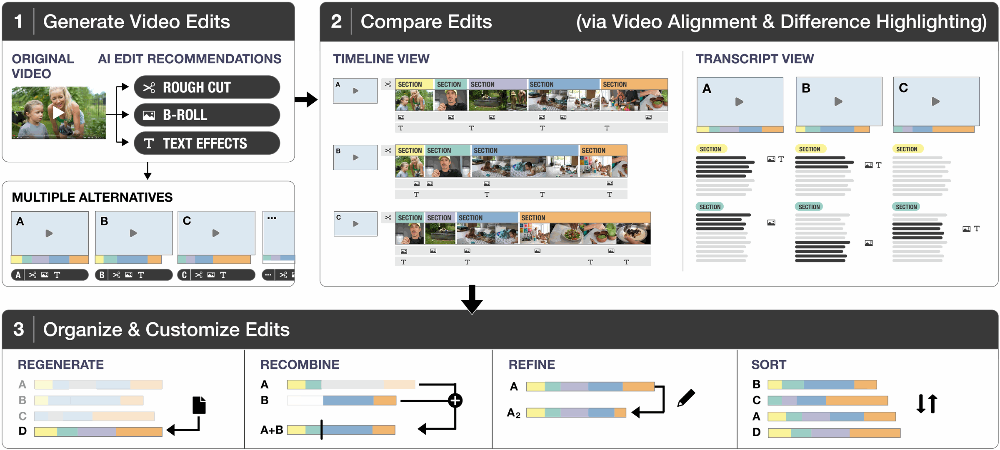

## 1. Introduction

As video has become a mainstream form of communication and storytelling, an increasing number of end users create and share videos. YouTube, which is considered the most popular video-focused social network, now has approximately 64 million creators worldwide (Duarte, [n. d.]).
Yet creating compelling videos is a complex and time consuming task. Creators need to find key moments (Wang et al., 2024c) and remove irrelevant and repetitive content (Fried et al., 2019; Huh et al., 2023b). They also spend time making the video more engaging with visual effects, B-roll (Huber et al., 2019), text (Xie et al., 2023), and music (Rubin and Agrawala, 2014).
Recent advances in video understanding and generative models have shown great potential for assisting video editing. Prior research has shown that AI tools can speed up multiple stages of video authoring including script writing (Mirowski et al., 2023), storyboarding (Wang et al., 2024b), asembling clips into rough cuts (Chi et al., 2013; Truong et al., 2016), identifying low-quality footage (Huh et al., 2023b; Fried et al., 2019), and adding B-roll (Huber et al., 2019).
Recent AI video products such as OpusClip (Clip, [n. d.]), CapCut (CapCut, [n. d.]), and Vizard (Vizard, [n. d.]) further streamline video editing by automatically making cuts, and adding transition effects and subtitles.

One powerful new capability enabled by generative AI models is the quick generation of multiple variations. This allows creators to explore many alternative stories or B-roll placements simultaneously, potentially resulting in better final videos (Dow et al., 2010; Suh et al., 2024). While most existing video editing tools are designed to handle only one video version at a time, recent AI tools such as OpusClip (Clip, [n. d.]) and Capcut (CapCut, [n. d.]) generate multiple variations of edited videos to offer diverse options to users. Despite the benefits of exploring alternatives in creative tasks, there are potential new burdens to users: 1) comparing the variations (Huh et al., 2023a; Gero et al., 2024) and 2) managing them over time (Reza et al., 2023; Suh et al., 2024).
While prior work explored sensemaking and comparison of multiple AI generations in text (Gero et al., 2024; Suh et al., 2023; Reza et al., 2023), images (Almeda et al., 2024; Huh et al., 2023a), and designs (Swearngin et al., 2020; Matejka et al., 2018), comparing multiple videos presents unique challenges due to the temporal nature of video. In this work, we explore this emerging approach to video editing centered on working with multiple variations.

To understand the opportunities and challenges of authoring videos with multiple alternatives, we conducted a formative study where 8 professional video creators were tasked with comparing multiple edited videos of the same source content.
Creators in our study mentioned that comparison is a common practice throughout their current video editing process as they consider alternative narratives, visual assets, or lengths of videos.
They also highlighted that having alternatives helps them reflect on their preferences and further plan editing directions, but it was time-consuming to manually create multiple versions. As AI speeds up the video creation process, we
envision that future video editing tools will more commonly provide users with multiple variations.

However, reviewing alternatives can require a lot of time and effort because creators must watch all the videos to compare them. Unlike static images or text, which can be quickly scanned for differences, videos unfold over time, requiring creators to watch, pause, and replay to detect variations in stories, transitions, and visual effects. Based on these findings, we derive 6 design goals for video editing tools centered on working with alternatives.
A tool to support creators in exploring video alternatives should minimize redundant watching (D1) and enable quick skimming of differences (D2) across different stages of the editing process (D3) in the most appropriate modality (D4). Such a tool should also help creators easily organize and customize variations to support them in finding a version with fewer errors (D5) and best suits their needs (D6).

We introduce  VideoDiff, an AI-powered video editing tool designed to enhance the creative potential of working with alternatives while minimizing the burden of comparison. VideoDiff generates diverse AI recommendations for each video editing task such as making rough cuts, inserting B-rolls, and adding text effects (Figure 1.1).
For each task, creators can quickly skim the differences between variations using VideoDiff which aligns the variations and highlights the differences using timelines, transcripts, and video previews (Figure 1.2).
Additionally, creators can sort variations to narrow down the options and further customize them by refining and regenerating AI suggestions (Figure 1.3).
In this work, we focus specifically on working with narrative videos such as lifestyle vlogs, podcasts, how-to videos, and travel videos.
Their descriptive dialogue makes them well suited to the current strengths of text-based large language models, which are good at extractive and abstractive summarization. Additionally, the source content for these types of videos is either one long video (e.g., presentation or an event) or multiple sources that can be sequenced in time because they capture chronological activities, such as a how-to demonstration or travel videos. This simplifies our visualization design to show how different versions relate to one another.

Figure 1. VideoDiff is a Human-AI co-creative system that supports video creators to explore multiple variations. 1) VideoDiff generates diverse AI recommendations for making rough cuts, inserting B-rolls, and adding text effects. 2) VideoDiff supports easy comparison by aligning videos and highlighting differences using timeline and transcript views. 3) Users can narrow down options by sorting and further customize them by refining and regenerating AI suggestions.

We evaluated VideoDiff in a within-subjects study with 12 video creators who compared VideoDiff with a baseline interface designed to encompass features of existing AI video editing tools (e.g., CapCut, OpusClip). Participants rated VideoDiff as more useful for quickly understanding the differences of multiple videos which helped them create and consider more diverse variations. Participants also expressed higher satisfaction with the final videos created with VideoDiff.
The contributions of our paper are as follows:

- We identify the challenges of comparing multiple variations in video editing and derive design goals for systems to support video creation with alternatives.
- We propose VideoDiff, an AI-powered video editing tool that supports video creation with alternatives by enabling efficient generation, comparison, organization, and customization of variations.
- Our user study findings showcase the advantages and challenges of using VideoDiff.
