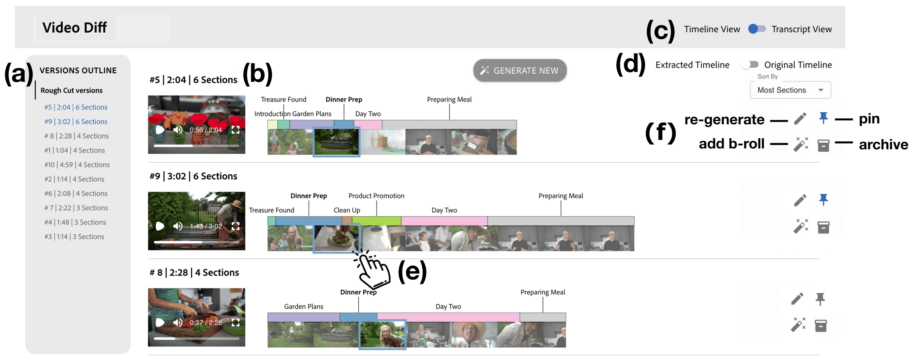
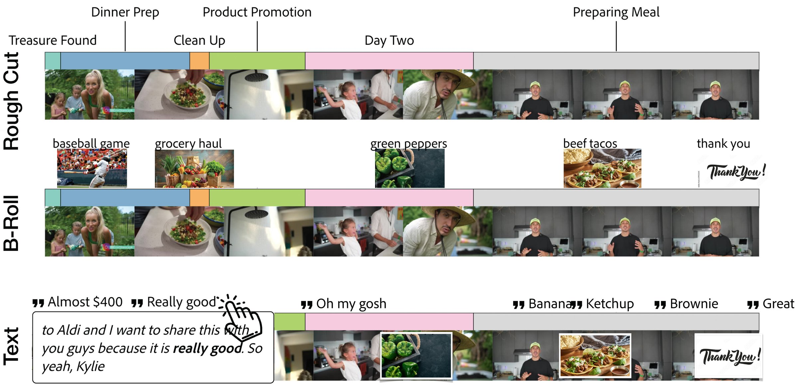
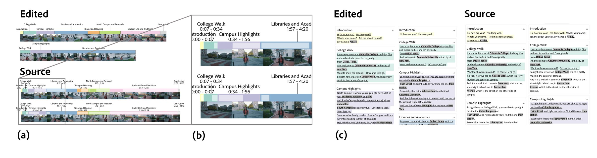
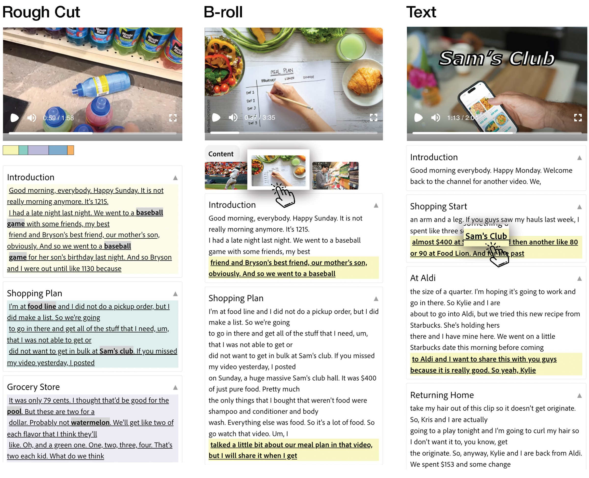
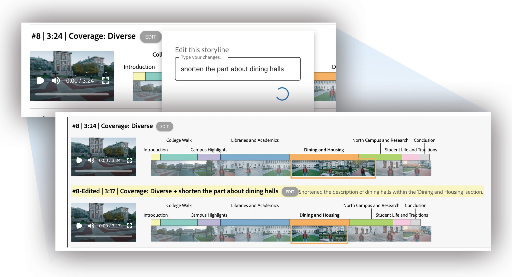

## 4. VideoDiff

We present VideoDiff (Figure 1), a human-AI video co-creation tool designed to support efficient video editing with alternatives.
With VideoDiff, users can generate and review diverse AI recommendations for 3 different video editing tasks: making rough cuts, inserting B-roll images, and adding text effects (D3).
VideoDiff supports easy comparison between alternatives by aligning videos (D1) and highlighting differences using timeline and transcript views (D2, D4)
. Users can organize and customize edits by sorting, refining, and regenerating AI suggestions (D6).

Figure 2. Overview of VideoDiff: Users can view an outline of the variations in the current editing stage (a). In this figure, we see 10 rough cut variations. The user can play videos of these different versions (b) and compare them in the transcript or timeline view (c).
Users can toggle between the edited and source timelines (d) to align videos to the source or edited context or click on each section to navigate directly to that part of the video (e).
Users can also sort variations by duration and the number of sections included, as well as pin, archive, or edit variations according to their preferences (f).

### 4.1. Scope

While VideoDiff provides visualizations that allow users to quickly identify and skim differences between video versions (D2), it is designed to go beyond the functionality of a diff tool, which typically focuses solely on highlighting changes or differences for review (Tharatipyakul and Lee, 2018; Baker et al., 2024). Instead, we designed VideoDiff as a human-AI co-creation tool that facilitates iterative generate-compare-refine interactions, revealing how comparing alternatives can influence and enhance users’ creative processes.

To help set context for VideoDiff, we define the different stages of video editing.
Rough cut creation is selecting good moments (or clips) from source footage to create a compelling story. Inserting B-roll images or video helps to make the video more interesting and dynamic. To insert good B-roll, creators should find effective images or videos that illustrate what is being said and place them appropriately. Inserting text effects helps emphasize parts of the narration through animation and stylized text. The AI algorithms for each of these editing tasks are in themselves hard technical problems, and we do not focus on them in this work. Our focus is on supporting users to work with the generated variations as part of the editing process. However, because we must support some editing in order to test our ideas, we have implemented basic versions of editing algorithms that leverage LLMs to process the video transcript and recommend rough cuts, B-roll, and text effects. A holistic solution with multimodal analysis of video, audio, and narration can offer better editing suggestions in the future.

Most video editing softwares offer more than the three stages that VideoDiff supports, such as applying color correction or cleaning up the audio. Our goal is not to create a fully functional video editor, but rather to explore how video editing might change as AI technologies enter more and more of the editing stages. As AI easily generates multiple editing recommendations, the video editing task shifts to involve more curation beyond just editing, and we must consider how to best support this transition.

### 4.2. Interface

VideoDiff is a web-based video editing tool (Figure 2) where users can generate, review, and customize video alternatives.
When the user uploads a video, VideoDiff first generates 10 rough cut recommendations. In the versions outline on the left, users can see the list of all variations in the current editing stage (Figure 2.a). Users can play the video of each version (Figure 2.b) or skim the differences using a timeline or transcript view (Figure 2.c). Users can toggle between showing only the edited or all of the source content for additional context (Figure 2.d). They can also click on any section to navigate directly to that part (Figure 2.e).
Users can sort, re-order, pin and archive the variations to organize them (Figure 2.f). Or they can refine or recombine existing variations or regenerate a new variation using text prompts.

Figure 3. At each editing stage, VideoDiff provides glanceable timelines for users to easily compare different variations. Users can click on any section, B-roll image, or text effect to jump to that part of the video and preview the effects.

Figure 4. Users can switch between the edited and original source timeline in the transcript (a) and timeline (b) views. This helps users see the edits in the context of the source content and compare which sections are included at a glance. The source view (c) shows users the location of the edited content in the context of the source view.

Comparing Variations with Timeline View.
VideoDiff provides different visualizations of timelines at each video editing stage (Figure3) so that users can quickly review and compare multiple alternatives (D3).
In the rough cut stage, VideoDiff uses  sections to visualize the timing and coverage of content in each variation.
Drawing upon prior work that has shown that grouping footage into thematically coherent chunks can help creators make video editing decisions (Leake et al., 2020; Huh et al., 2023b), we explore how chunking into sections can aid comparison of edited videos.
Instead of segmenting each rough cut variation to identify sections, VideoDiff extracts sections from the source footage and applies them consistently across all variations. This allows users to easily align the variations and see how different versions include or exclude certain sections and cover varying parts or lengths of each (D1-D2).
Users can toggle between edited and source timeline views (Figure 4.a) to align the videos based on the edited or source video timeline. The edited timeline allows users to quickly skim the video’s overall duration, along with the placement and proportion of each section. By hovering over a section, users can view relevant video thumbnails and click to play the video from that point.
With the source timeline, users can easily understand which parts of the source video are extracted. In the formative study, video creators often compared edited videos to the source videos to verify any missing key information. Drawing from this observation and aligning with D1, we use the source video as an anchor for aligning rough cut variations for comparison.
For example in Figure 4.b, while the edited timeline shows that both versions have a similar duration for “Campus Highlights” section, the source timeline reveals that each version covers different parts of the source footage on “Campus Highlights”. By hovering over the lighter-colored boxes indicating excluded parts, users can see which video thumbnails and topic keywords are not covered.

Once the user chooses a rough-cut version, they can generate 10 videos with different B-roll recommendations. In the B-roll stage, VideoDiff’s timeline view shows the B-roll thumbnails on top of the rough cut timeline bar, along with the keyword used to search for the B-rolls (Figure 3). Users can hover over the B-roll thumbnails to see which video scene each B-roll covers and click thumbnails to play the video and preview how the B-roll is inserted into the footage. After selecting a B-roll version, users can generate 10 new videos with different text effect suggestions. Instead of showing video thumbnails with text effects, we display the keywords where the text effects are applied, as text effects on thumbnails are too small to skim.
Users can hover over a keyword to view the narration sentence for context, and click on the keyword to play the video and preview how the text effects are integrated into the footage.

Figure 5. At each editing stage, VideoDiff provides glanceable transcripts so that users can easily review and compare different variations. In rough cut transcripts, visually concrete keywords (Leake et al., 2020) are emphasized in bold, allowing users to easily skim through the content of each variation. Users can click on section headings, B-roll images, or text effects to jump to that part of the video and preview the effects.

Comparing Variations with Transcript View.
VideoDiff’s transcript view allows users to quickly skim the transcripts to understand the differences of variations in each editing stage (Figure 5).
The transcript is divided into sections and users can click on the section headings to play the video from the starting point of each section.
During the rough cut phase, VideoDiff aids users in maintaining context while toggling between transcript and timeline views by showing a mini timeline within the transcript view. It also uses consistent color coding to denote sections across both views.
In the transcript, visually concrete keywords (Leake et al., 2017) are emphasized in bold, allowing users to skim through the content of each variation  [Footnote: We used GPT-o to identify visually concrete keywords with few-shot examples.] .
Similar to the timeline view, users can also switch to the source transcript view (Figure 4.c) and see the complete transcript and identify which parts of the source text are excluded in each section. We synchronize the scrolling across multiple transcripts, allowing users to easily compare variations side-by-side (D1).

For quick skimming of B-roll and text effects options, VideoDiff highlights sentences in the transcript where these effects are applied (D2, Figure 5). Users can click on the B-roll thumbnails or text effects to preview the video from the moment the effect appears.

Organizing Variations.
To help users to easily explore and narrow down the search space of alternatives, VideoDiff supports sorting of variations in each stage. In the rough cut stage, users can sort based on the edited video duration and the number of sections, and in the B-roll and text effects stages, users can sort based on the number of effects and the media type of B-rolls (image, illustration, video) or style of text effects (title, subtitle, lower thirds).
Additionally, users can manually pin preferred versions to the top or archive unwanted versions to the bottom, which is also reflected in the outline view.

Figure 6. Using VideoDiff, users can edit a variation, recombine multiple variations, and generate a new variation using text prompts. For each new generation, VideoDiff summarizes the changes so that users can easily verify the result.

Customizing Variations.
When users are not satisfied with the initial recommendations of VideoDiff, they can further edit existing versions or generate new alternatives (D6, Figure 6).
Users can provide a text prompt to guide the generation of new alternatives (e.g., Show many text effects when I talk about grocery items.), or click “Surprise me” to have VideoDiff suggest a new alternative that is different from existing variations.
Users can also recombine existing versions by specifying the version IDs and how to merge them in the text prompt (e.g., Use first two B-roll images from #3 and last B-roll image from #7.). By default, generated new results are pinned to the top for easy discovery.
Using VideoDiff, users can also edit existing versions with a prompt (e.g., Shorten the part when I’m talking about the meal plans.). The new generation from the edit prompt is displayed right below the original version for quick comparison and VideoDiff also describes specific changes made for quick verification of edits (D2). For example, in Figure 6 the user tells VideoDiff to “shorten the part about dining halls” and the system responds:
“Shortened the description of dining halls within the Dining and Housing section”.

### 4.3. Implementation & Prompt Engineering

We implemented VideoDiff using React.js and d3.js. For embedding a video player, we used Remotion (Remotion.dev, 2024) to render the edited video and overlay B-rolls and text effects.
When users upload a video, VideoDiff uses OpenAI’s Whisper API to transcribe the video. VideoDiff is powered by OpenAI’s GPT-4o and uses prompt engineering for 1) segmenting video into sections and identifying visually concrete keywords, 2) generating multiple alternatives of edit recommendations for rough cuts, B-rolls, and text effects, and 3) parsing and executing users’ new generation prompts and summarizing changes.
To ensure VideoDiff provides diverse edit recommendations in each stage, we use  augmentation prompts (§B) to control the generation of suggestion (e.g., by specifying duration and section coverage for each rough cut recommendation).
