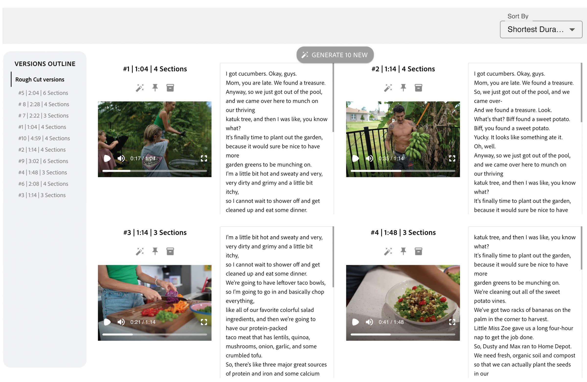
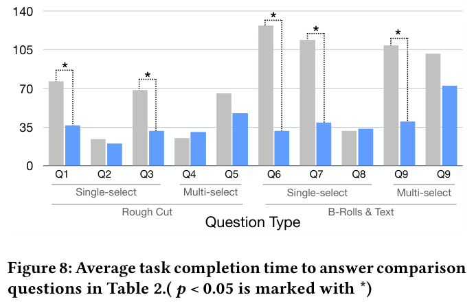
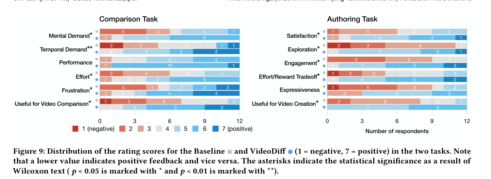

## 5. User Evaluation

To understand how well VideoDiff assists users in comparing multiple AI-edited videos, we conducted a within-subjects study with 12 video editors comparing VideoDiff to a baseline.
Our study aims to investigate the following research questions:

- How well does VideoDiff support video comparison?
- Compared to the baseline, VideoDiff significantly decreases the time in video comparison (H1), improves comprehension and accuracy in video comparison (H2), lowers cognitive load (H3), and is more useful for video comparison (H4).
- How well does VideoDiff support video authoring?
- Compared to the baseline, VideoDiff significantly increases satisfaction in the final video (H5), provides better creativity support (H6), and is more useful for video authoring (H7).
- How does VideoDiff impact video editing workflows?

### 5.1. Method

Participants.
We recruited 12 participants with diverse video editing experiences using mailing lists (P9-P20, Table 4). 6 of them (P9-P14) described themselves as proficient, having 8.33 years of video editing experience (SD=2.94). The other 6 participants (P15-P20) identified as beginners with 3.83 years (SD=1.17) of experience. We compensated $75 to professional video editors and $30 to amateur editors for the 1.5-hour remote study conducted via Zoom.

Figure 7. The baseline interface shares a similar UI design and features with existing AI video editing tools that support generating multiple videos (e.g., OpusClip, CapCut).

Baseline.
The baseline (Figure 7) shares a similar UI design and features with existing AI video editing tools that support generating multiple videos (e.g., OpusClip, CapCut). When the user uploads source footage, the baseline system generates 10 different videos with different rough cuts and B-rolls applied. Users can sort the clips based on the duration and the number of effects.

Materials.
We selected 3 videos (V0-V2, Table 1) from YouTube that feature primarily raw footage with few edits, real-world camera footage rather than screen recordings, and have narration. V0 was used in the tutorial session for both VideoDiff and baseline conditions.
For the main study, we selected two videos (V1-V2) from the same YouTube channel which are similar in terms of length, amount of narration, and scene changes. We asked participants to watch and familiarize with the original videos prior to the study.

|  |  |  |  |  |
| --- | --- | --- | --- | --- |
| Video ID | Video Type | Duration | Task | URL |
| V0 | Campus Tour | 12:28 | Tutorial | (Admissions, 2023) |
| V1 | Grocery Haul | 12:41 | Comparison | (Rose, 2024b) |
| V2 | Grocery Haul | 13:10 | Comparison | (Rose, 2024a) |

Table 1. Videos used in the evaluation study.

|  |  |  |
| --- | --- | --- |
| Edit Stage | Category | Example Questions |
| Rough-cut | Single-select | (audio) Q1. Which video talks about most grocery items? |
| (audio) Q2. Which video mentions the calories of strawberry lemonade? |
| (visual) Q3. Which video features the highest proportion of talking heads? |
| Multi-select | (audio) Q4. Which videos mention her salad recipe? |
| (visual) Q5. Which videos show the scissors? |
| B-roll &  Text effects | Single-select | (visual) Q6. Which video has the most B-rolls showing food? |
| (visual) Q7. Which video shows the B-roll image when talking about the protein bar? |
| (both) Q8. Which video shows a B-roll image when talking about Z-bar? |
| Multi-select | (visual) Q9.Which videos show B-rolls with hamburgers? |
| (both) Q10.Which B-rolls are shown when talking about the restaurant? |

Table 2. Questions used in the user study’s comparison task included both single-select (choosing one answer that meets the criteria) and multi-select (selecting all answers that meet the criteria) formats. These questions required participants to check either the narration, visuals, or both, with the specific questions varying depending on the assigned video.

Procedure.
We started the study with demographic and background questions about the participants’ current video editing practices. Next, we gave a 10-minute tutorial on both VideoDiff and the baseline interface using V0. The participants then completed two tasks: the comparison task (RQ.1) and the authoring task (RQ.2-RQ.3). The comparison task studies how users use VideoDiff when the comparison is an end goal in itself and the authoring task explores when the comparison is the means to accomplish the higher-level goal of creating the final video.
In the comparison task, participants reviewed 10 different videos using VideoDiff or baseline to answer comparison questions (Table 2). We derive these questions from the formative study to consider what aspects video editors compare to select the video they preferred: the content of the videos (e.g., which key visual scenes are included or which key concepts are mentioned) and the editing techniques applied (e.g., the style, placement, and frequency of visual effects).
We aimed to cover diverse types of tasks, including both single-select and multi-select formats, as well as questions that required participants to assess narration, visuals, or a combination of both.
Also, our questions cover both comparison modes identified by Gleicher et al. (Gleicher et al., 2011):  explicit comparison where targets are known and available (e.g., Q4. Which video mention her salad recipe?) and  implicit comparison where targets are hidden, requiring more exploratory search (e.g., Q3. Which video features the highest proportion of talking heads?).
In each interface condition, users were assigned to one of V1-V2.
For each question type, we measured the time taken, answer accuracy, and interaction logs to understand which system components participants utilized to perform each comparison. For accuracy, we assigned a rating of 1 if the answer was completely correct, 0.5 if the participant got half or more of the answers right for multi-select questions, and 0 if less than half or none were correct.
After each interface, we conducted a post-stimulus survey that included the following ratings: mental demand, performance, effort, frustration, and usefulness of the system in understanding differences between videos. All ratings were on a 7-point Likert scale.

In the authoring task, participants reviewed the video suggestions and further edited videos using VideoDiff or baseline. In each interface condition, users were assigned to one of V1-V2.
We guided participants with an editing scenario: “You have created this initial video about grocery haul. To edit this video you can review AI’s 10 different edit suggestions to select the final video or regenerate, refine, or recombine edit suggestions.” After each interface, we conducted a post-stimulus survey to measure users’ level of satisfaction with the final video, creativity support indexes (exploration, engagement, effort/reward tradeoff, expressiveness) (Cherry and Latulipe, 2014), and usefulness of the system in video authoring.
In both the comparison and authoring tasks, the order of the interfaces and videos was counterbalanced and randomly assigned to participants.

### 5.2. Comparison Task Results

Overall participants rated VideoDiff to be significantly more useful in understanding differences (Figure 9, $\mu$=4.92, $\sigma$=1.16 vs. $\mu$=2.25, $\sigma$=1.06; $Z$=-2.77; $p$<0.05). In this section, we share 1) participants’ strategies for reviewing and comparing videos to answer comparison task questions, 2) task results (RQ1), and 3) perceived workload (RQ1).

Comparison Strategies.
To narrow down the search space, 5 participants in the baseline condition (P9, P11, P14, P17, P19) and 6 participants in VideoDiff condition (P11, P14, P17-P20) first sorted variations based on the comparison question (e.g., sort by longest duration for Q1). With VideoDiff, 2 participants first identified which section is relevant to the question (e.g., “Meal Plan” section for Q9) then only checked within the variations that covered the section (P9, P18).
All participants using VideoDiff switched between timeline and transcript views depending on the question type. They used the edited view to find what each variation covers, and 2 participants additionally utilized the source view to align videos side by side (P10, P19). 3 participants were initially unsure which view would be more helpful for a specific comparison question and tried switching views multiple times (P12, P14-P15).

To answer the questions that require visual comparison between videos, all 12 participants in the baseline condition frequently interacted with the video player of each variation directly. Participants scrubbed the video player timeline to skim through the visual content of the video or click-jumped to navigate to different parts of the video.
After finding the visual of interest in one video, 4 participants tried to navigate to the similar timestamp in other videos but realized they needed to re-search as all videos extract different parts of the video.
As searching in each variation took time, P12 took notes to remember the details in each variation. She noted  “10 is a lot to compare at once. I need to take notes.”
Because participants could not preview thumbnails of multiple videos in parallel, 2 participants tried playing multiple videos synchronously but found it challenging to compare them as they were not aligned (P13-P14). As it was time-consuming to review the visuals of each variation, 4 participants used a workaround by searching for relevant keywords in the transcript (P14, P17-P19). P19 searched  “I got ” to check what grocery items are mentioned in the narration.

Participants using VideoDiff mainly checked the timeline view to identify the shots included in each variation for rough cut comparison. If a timeline did not display a thumbnail of the visual they were searching for, 3 participants further ensured that the missing thumbnail was not simply due to the periodic nature of frame extraction while the visual is actually present in the video. P9 and P15 located sections that have thumbnails with similar background and shot type, navigated to the part and scrubbed the video player to skim the visuals. Similarly, P19 reviewed the  source timeline view to check whether the frame of interest was present outside of selected sections.
When looking for specific B-roll images, P18 mentioned the benefit of visual keyword search using the B-roll keywords in the timeline view. To check the video context when a B-roll or text effect was applied, participants either reviewed the thumbnails below the effects or clicked on the effects to preview them.

For questions that involve checking the audio (i.e. narration) of the video, participants in both conditions used keyword search (ctrl-F) in the transcript.
In the baseline condition, 5 participants read the transcript of each variation sequentially which was time-consuming (P9, P11, P14, P18-P19). P19, a low-vision participant noted  “In this version [Baseline], it is mostly reading than watching so very tiring for my eyes!”
With VideoDiff, 2 participants first searched where the relevant part appears in the transcript in one of the variations, then scrolled horizontally to quickly compare whether other variations cover the part using  source view (P9, P14).

Time and Accuracy for Comparison Task.
We report the results of the comparison task in Figure 8 (task completion time) and Table 3 (task accuracy). On average, participants spent 38 seconds (SD=14) for each comparison question with VideoDiff, roughly half the time spent with the baseline (74 seconds, SD=38). In 5 questions that required checking multiple parts of the video (e.g., Which video has the most B-rolls showing food?), participants using VideoDiff were significantly faster than in Baseline.
In the baseline, 8 participants failed to find the correct answer for one or more questions within the 3-minute limit (P9, P12-13, P15-P16, P18-P20). 5 participants provided a rough guess answer instead of carefully comparing variations after watching the first few videos (P9, P12, P16-P18). P16 notes  “In only three minutes? I’ll just have to guess as I cannot watch all these videos.”

Figure 8. Average task completion time to answer comparison questions in Table 2.( p < 0.05 is marked with \*)

Baseline participants often provided incorrect or incomplete answers when the question involved visual comparison. 3 participants who scrubbed the timeline to search for an object missed it when it only appeared for a short amount of time (P11, P17-P18). While 2 participants searched keywords related to the visual in the transcript to speed up the search, some videos only mentioned the object and did not show it (P12, P17).
While VideoDiff’s filmstrip in the timeline enabled participants to more quickly compare the visuals of multiple variations, 5 participants missed the visual search question (Q5) when the object asked only appeared briefly in the video and was not captured in the filmstrip.

|  |  |  |  |  |  |  |  |  |  |  |
| --- | --- | --- | --- | --- | --- | --- | --- | --- | --- | --- |
|  | Q1 | Q2 | Q3 | Q4 | Q5 | Q6 | Q7 | Q8 | Q9 | Q10 |
| Baseline | 0.67 (0.49) | 1.00 (0.00) | 0.42 (0.51) | 0.96 (0.14) | 0.63 (0.31) | 0.50 (0.52) | 0.36 (0.50) | 0.92 (0.29) | 0.46 (0.40) | 0.67 (0.25) |
| System | 0.92 (0.29) | 1.00 (0.00) | 1.00 (0.00) | 1.00 (0.00) | 0.75 (0.34) | 1.00 (0.00) | 0.90 (0.32) | 0.91 (0.30) | 0.96 (0.14) | 0.86 (0.23) |

Table 3. Task Accuracy for answering comparison questions in Table 2. The value represents the average accuracy (SD).

Cognitive Load in Video Comparison.
Figure 9 shows the distribution of survey ratings. Our NASA-TLX (Hart, 2006) results indicate that
VideoDiff required significantly less mental demand ($\mu$=4.33, $\sigma$=1.4 vs. $\mu$=2.75, $\sigma$=0.97; $Z$=-2.08; $p$<0.05), temporal demand ($\mu$=4.33, $\sigma$=1.72 vs. $\mu$=2.33, $\sigma$=1.15; $Z$=-2.36; $p$<0.01), effort ($\mu$=4.42, $\sigma$=1.08 vs. $\mu$=2.92, $\sigma$=1.08; $Z$=-2.62; $p$<0.05), and frustration ($\mu$=3.75, $\sigma$=2.01 vs. $\mu$=2.33, $\sigma$=1.37; $Z$=-1.78; $p$<0.05). We did not see any significant difference in performance ($\mu$=3.08, $\sigma$=1 vs. $\mu$=2.17, $\sigma$=0.94; $Z$=-1.66; $p$>0.05).
Participants using baseline mentioned the challenge of finding relevant parts with a video using a video player and transcript and having to repeat the process for multiple variations. P15 noted  “It is more tedious than demanding. All videos are not visually distinct so I have to do a lot of manual digging.”

After using VideoDiff, participants appreciated having separate views to compare videos across timelines and transcripts. P11 mentioned the benefit of having both in separate views  “If I’m shown both views at once, it is too overwhelming and will not fit multiple versions in a page.” P10, P13, and P19 highlighted that the same color coding of sections across timelines and transcripts helped them pick up information easily. P13 said “While this one [VideoDiff] has much more information with many different view options, they are not overwhelming and all very helpful and complementary.” P10 expressed that she wants to use VideoDiff in the future to show her clients multiple versions of videos she has created.

Figure 9. Distribution of the rating scores for the Baseline  and VideoDiff 
(1 = negative, 7 = positive) in the two tasks. Note that a lower value indicates positive feedback and vice versa.
The asterisks indicate the statistical significance as a result of Wilcoxon text ( p < 0.05 is marked with \* and  p < 0.01 is marked with \*\*).

### 5.3. Authoring Task Results

Overall participants rated VideoDiff to be significantly more useful for creating videos (Figure 9, $\mu$=3.25, $\sigma$=0.87 vs. $\mu$=5.42, $\sigma$=0.51; $Z$=2.97; $p$<0.05). In the followings, we share 1) participants’ strategies for reviewing and customizing variations for creating a video (RQ3) 2) how well VideoDiff supports creativity (RQ2) and 3) future improvements suggested by participants.

Reviewing Variations and Converging.
In the baseline condition, participants mentioned the difficulty of understanding the differences and quickly identifying which one aligns best with their preference. Thus, 3 participants quickly selected the longest video as they were likely to cover most of the original video (P12-P13, P16). P16 mentioned  “I cannot understand what each version is about, so I’ll choose the longest one and import it into my own video editor to cut down further.” Similarly, when reviewing the baseline’s B-roll recommendations, P18 chose a version with the most B-rolls as it was easier to remove than add them manually.
4 participants who first edited videos with the baseline mentioned feeling overwhelmed by starting with 10 alternatives and wanted fewer variations (P10-P12, P14). However, when they used VideoDiff to create videos in the following sessions, P10 and P14 changed their opinion and stated that they liked having 10 variations as a start. P14 said “Because I can quickly skim the differences with visuals and zoom out, the same amount of suggestions don’t feel overwhelming here. ”

When creating videos with VideoDiff, all participants started in the timeline view and narrowed down the search. To closely compare final candidates or verify edits, 10 participants switched to the transcript view for a side-by-side comparison. P16 said “You cannot zoom out and view all text in the transcript at once. It’s possible with the timeline view.”
Similarly, P17 compared two views: “Timeline view is helpful for creating bones of the videos, deciding what to show for how long. Transcript helps with individual details.” 
2 participants never used the transcript view and finished editing in the timeline view (P17, P19). P19 said  “All video editing software that I use shows timeline, so I’m not used to editing with the transcript view.”

In the rough cut stage, participants sorted and shortlisted variations based on the coverage of sections they were interested in. 3 professional video editors highlighted the benefit of segmenting the video into sections (P9, P11, P14). P14 mentioned “This is exactly what I do manually every time I start video editing, using colors to differentiate my shots in Premier Pro. This system [VideoDiff] will save me so much time when I’m working on 2-3 hour-long videos.”
P15 who narrowed down the rough cut versions to 2 candidates first added B-rolls to both versions to inform decision-making in the rough cut stage. She explained “If one version has a part that I can add nice B-rolls, I’ll go for that [Rough cut version].”
When reviewing B-roll and text effect recommendations, participants checked whether the effects were evenly distributed throughout the video using timeline view (P12, P17), whether the B-roll aligns with the narration in the transcript view (P9, P11), and whether the B-rolls and text effects are visually aesthetic and match the style of the video by previewing in the video player (P13).

Generating and Editing Variations.
In the baseline condition, only 2 participants generated a new set of variations (P11, P13) while the other 10 participants selected the final video from the initial recommendation without further change. P19 said  “I wouldn’t generate new videos because that would require another comparison! After generating new recommendations, P11 noted  “It is difficult to know how these videos are different from the original variations.”

Participants who created videos using VideoDiff made 4.33 edits to existing variations (SD=2.42).
2 participants combined existing versions (P13, P19) and
3 participants generated new variations (P11, P16-P17). During the rough cut stage, many participants made edits related to sections, such as adding or removing sections, adjusting the coverage of sections, or reordering them. Participants made more edits focused on visual changes in the timeline view (P20 edited “Show less talking heads, show more grocery items”), while they made more edits related to narration in the transcript view (P17 edited “Do not mention the store name”). While most participants iteratively made edits on the first rough cut variation they selected, P18 switched to another version after making 3 edits on a rough cut version. He described “After making a few edits on this one, I realized that I didn’t really like it. It’s really useful to explore multiple paths at once, and be able to switch between them easily.”

In the B-roll and text effects stage, participants made edits to add/remove an effect, move the effect to a different part of the video by specifying a timestamp or a transcript sentence, and change the B-roll images or text styles. Participants noted that VideoDiff’s description of specific changes makes it easy to verify new changes without having to play the videos before and after the changes.

Video Diff as a Creativity Support Tool.
We assessed VideoDiff and the baseline using creativity support index (Cherry and Latulipe, 2014) (Figure 9).
VideoDiff supported efficient exploration and comparison between variations ($\mu$=2.5, $\sigma$=0.9 vs. $\mu$=5.33, $\sigma$=0.78; $Z$=3.07; $p$<0.05), which enabled participants to quickly narrow down the search and spend more time customizing them. This led to higher effort–reward tradeoff ($\mu$=3.42, $\sigma$=1.24 vs. $\mu$=5.67, $\sigma$=0.89; $Z$=2.89; $p$<0.05) and higher satisfaction in the final result in VideoDiff than in the baseline ($\mu$=3.67, $\sigma$=0.98 vs. $\mu$=5.25, $\sigma$=1.06; $Z$=2.63; $p$<0.05). After creating the final video with VideoDiff, P13 said  “I can see that this version covers all sections in a balanced way and has many aesthetic B-rolls, so I’m confident that I chose the right one.”

Participants were also more engaged in the creative process with VideoDiff than the baseline ($\mu$=2.83, $\sigma$=0.83 vs. $\mu$=5.67, $\sigma$=0.89; $Z$=3.05; $p$<0.05). P15 compared the experiences in both conditions: “In the first session [Baseline], I had to read the redundant transcript over and over, and having to read most of the time when I’m trying to create a video is not so fun. With this one [VideoDiff], I didn’t need to do repetitive work and could experiment what AI can do, so really enjoyed using it!”
For expressiveness, we did not see any significant difference between two conditions ($\mu$=2.83, $\sigma$=1.27 vs. $\mu$=4.75, $\sigma$=1.14; $Z$=2.46; $p$>0.05).
All participants using the baseline interface felt disengaged from the creative process due to limited control over the generation and a lack of understanding of the variations. P19 stated “There was no creation in this process, I was just selecting like a judge.” Similarly, P11 said “While being able to generate 10 recommendations is impressive, I’m not providing any input so I don’t feel like I’m the one creating something.”
In the VideoDiff condition, participants showed mixed perspectives towards VideoDiff as a creativity support tool.
P11 described “Instead of spending most of the time reviewing, it [VideoDiff] helped me to quickly move on to the creative stage and spend more time and effort there.” P14 elaborated “This tool [VideoDiff] helped me with tedious choices so that I can spend more time on meaningful choices.”
On the other hand, P10 mentioned that VideoDiff does not make her feel as expressive as using her existing tools. “While this is helpful for making things faster, it feels like I’m supervising AI instead of me being creative. I might feel less attached to what I create with this tool.”

Future Improvements for VideoDiff.
Participants provided suggestions on how to improve VideoDiff in the future.
First, P13 and P20 suggested that VideoDiff can provide alternatives whenever participants request edits to existing variations. Current VideoDiff provides only one edited variation based on the user’s edit prompt. Thus, when the new variation does not align with the user’s intent, they have to refine the edit prompt multiple times. P20 described “I cannot always be specific because I forget to specify all the details in the prompt or I often do not know what I want. When I ask it to “shorten grocery haul”, it can generate 3-4 versions with different parts dropped.”
Second, 5 participants (P9-P11, P14, P16) wanted more direct control with VideoDiff. P11 described “While I can change the duration or change B-rolls using prompt-based editing, some of these are easier with directly stretching the timeline or right clicking on B-rolls.” P9 also suggested having a slider to control the number of B-rolls and text effects easily. P16, an amateur video editor mentioned “Instead of exporting this and further refining using Premier Pro, I just want to finish everything here and directly publish without having to work twice.”
Third, P14 mentioned that future VideoDiff can improve its generation pipeline to consider visuals into account when generating rough cuts and inserting B-rolls. P14 explained “I want B-rolls to be placed where the jump cuts are or when there are no interesting visuals. Now it covers the original video’s bananas with a B-roll bananas.”
Finally, P19 a low vision participant provided insightful feedback to make VideoDiff more accessible to blind and low vision video creators. For low vision users who may find reading transcript challenging, VideoDiff can include more detailed subheadings summarizing the transcript’s content, in addition to the current section titles, to reduce the amount of reading required. For screen reader users, providing more descriptive text for visuals (e.g., alt-text that describes differences between 2 similar B-roll images (Huh et al., 2023a)) can support accessible visual comparison of videos.
