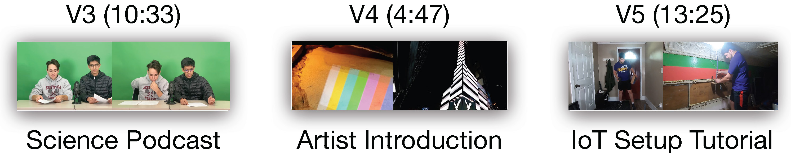

## 6. Exploratory Case Studies

The controlled user study (Section 5) showed that video creators found it easier to comprehend differences and create videos using VideoDiff compared to the baseline. To learn how creators would use VideoDiff to edit their  own footage, we conducted an exploratory study with 3 video creators (P9, P21-P22) who brought their footage.

Figure 10. In exploratory case studies, creators edited their own footage (V3-V5) using VideoDiff.

### 6.1. Method

We recruited 3 video editors (2 professionals, 1 amateur) using mailing lists and social media (P9, P21-P22). P9 also participated in the controlled user evaluation study. Before the study, we collected footage from each participant (Figure 10). P9 and P22 who wanted to use multiple clips in the study concatenated them into a single source video.
During a 1hr remote study session, we asked participants background questions, provided a tutorial of  VideoDiff, invited participants to edit their own footage with  VideoDiff, and asked participants semi-structured interview questions about their experience. We compensated participants $75 via Amazon Gift Card for preparing the footage and participating in the study.

### 6.2. Three Vignettes: VideoDiff in Context

V3: Science Video Podcast.
P21 is a college student who creates videos for a personal YouTube channel and school projects. For his physics class, he created a video podcast that parodies golf announcers to explain Newton’s law in a fun way. His goal for editing was to make an informational and entertaining video while describing all three of Newton’s laws. With VideoDiff’s initial rough cut suggestions, he first shortlisted versions with many sections which are likely to cover all three laws. P21 noted  “It’d be nice if I could ask it to filter out versions that do not cover all three laws”. While he chose a longer rough cut version to further edit, he also pinned a shorter version, which primarily consisted of jokes, to use as a teaser for his main video.
When reviewing VideoDiff’s B-roll recommendations, he looked for a version with a more consistent style of B-rolls as he was making an educational video. He liked having abundant options for B-rolls and recombined suggestions to create a version that has many infographic illustrations.
For text effects, he wanted to insert a chapter text for each law but noticed that most versions focused on formulas or jokes. He generated a new version by specifying  “Show a lower-third text of what each chapter is about.”
In the future, P21 wished that VideoDiff would gradually learn from his selection of alternatives and offer more personalized alternatives.  “Like reinforcement learning, I want it to learn my preferences over time so I can spend less time customizing.”

V4: Artist Intro Video.
P22 is a professional video creator who often edits music/art videos and documentaries for clients. He is making an artist intro video with the footage he got from a client and used VideoDiff to make edits. His goal for editing was to fit the video into 2 minutes while talking about the major art pieces.
When reviewing rough cut variations, P22 first noticed that #7 and #8 are both close to 2 minutes, and compare them side-by-side in the transcript to choose a version that mentions more art pieces of the artist.
While he tried to edit the video with a prompt  “Remove shots with flashing lights.”, he noticed that they still remained in the video.
In the B-roll stage, P22 did not apply any B-roll and explained “I want to show the artist’s own art images rather than stock images.” He suggested that in the future, VideoDiff can recommend zoom and pan animations for B-roll, as well as movements for text effects, and display them side by side for comparison.
He wanted to continue using VideoDiff as part of his workflow as the alternatives gave him new ideas.  “My brain starts to lock once I start manually editing. Even when I try to tweak to something different, it gets fixated easily. It will be always useful to have alternatives.”

V5: IoT Setup Tutorial.
P9 is a freelancer video creator who edits videos for YouTuber’s vlogs and product reviews. One of the YouTubers asked him to edit their raw footage of a IoT setup tutorial to remove mistakes and make a polished video.
P9 first chose one rough cut version and tried to make a section longer by editing with a prompt “Add more footage for hotspot installation.”. After noticing that VideoDiff generated a too long version, he switched to the transcript view to check what specific sentences he want to add and refined the edit prompt.
After reviewing the footage, P9 noticed a lot of repetition in the sentences as the YouTuber corrects themselves.
He edited the video to remove the repeated sentences and also prompted VideoDiff to cut when the YouTuber is out of the frame. However, he noticed that VideoDiff hallucinated that it had cut the parts out when they were still present.
He mentioned that while VideoDiff is great at making a rough version of a video, he still needed to rely on other tools to manually remove filler words and polish the video. P9 described “Usually making a rough cut for a video this long takes about 2 hours, but today I did it in 5 minutes. Although I still have to polish it up, this is so useful!”
